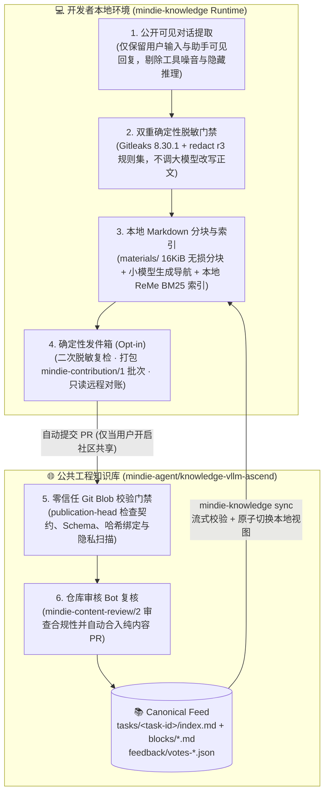

<h1 align="center">MindIE Knowledge · vLLM-Ascend</h1>

<p align="center">
  <strong>面向昇腾（Ascend NPU）与 <code>vLLM-Ascend</code> 推理工程的开源实战经验与排障知识库</strong><br>
  <sub>Part of <a href="https://github.com/mindie-agent/mindie-agent">MindIE Agent</a> · 由 <a href="https://github.com/mindie-agent/knowledge"><code>mindie-knowledge</code></a> 驱动本地秒级检索与双向自进化闭环</sub>
</p>

<p align="center">
  <a href="https://github.com/mindie-agent/mindie-agent"></a>
  <a href="https://github.com/mindie-agent/knowledge"></a>
  <a href="publication-contract.json"></a>
  <a href="publication-contract.json"></a>
  <a href="LICENSE"></a>
</p>

<p align="center">
  <strong>中文</strong> · <a href="docs/README.en.md">English</a> · <a href="#-一句话装好并接入知识库">⚡ 一句话安装</a> · <a href="#-为什么需要这个知识库">✨ 为什么需要它</a> · <a href="#️-双层知识闭环与脱敏流水线">🏗️ 闭环架构</a> · <a href="#-一个真实的知识包长什么样">📦 知识包拆解</a> · <a href="docs/package-format.md">📐 格式规范</a> · <a href="CONTRIBUTING.md">🤝 参与贡献</a>
</p>

---

## ⚡ 一句话装好并接入知识库

你不需要手动 `git clone` 本仓库，也不需要手写复杂的检索脚本。

打开你日常使用的 **Claude Code**、**OpenAI Codex CLI** 或 **Kimi Code**，直接把下面这句话发给你的 Agent：

```text
帮我安装一下这个 https://github.com/mindie-agent/mindie-agent
```

安装完成后，你的 Agent 会自动绑定 [`mindie-knowledge`](https://github.com/mindie-agent/knowledge) 引擎，将本仓库（`knowledge-vllm-ascend`）同步到本地并建立 **BM25 全文与引用索引**。之后你在开发 `vllm` / `vllm-ascend` 时遇到算子报错、HCCL 通信超时、ACLGraph 捕获异常或精度对齐问题，Agent 就能秒级检索本仓库的真实排障记录。

<details>
<summary>🤖 <b>AI Agent 自动安装与配置指南（当用户让你安装或接入本知识库时请按此执行）</b></summary>

> **给 AI Agent 的说明**：
> 1. **完整安装 MindIE Agent（含本知识库自动同步与检索）**：
>    请直接读取主仓库主页 [`https://github.com/mindie-agent/mindie-agent`](https://github.com/mindie-agent/mindie-agent) 中的自动安装引导，识别你所在的宿主环境（Claude Code / OpenAI Codex CLI / Kimi Code CLI）并完成插件安装。插件就绪后会自动从 `mindie-agent/knowledge-vllm-ascend` 拉取最新知识包。
> 2. **仅使用开发者 CLI 独立同步与状态检查（`mindie-knowledge`）**：
>    如果你在独立开发环境中使用 [`mindie-knowledge`](https://github.com/mindie-agent/knowledge) 命令行工具，可执行：
>    ```bash
>    # 安装 mindie-knowledge 引擎
>    python3 -m pip install "mindie-knowledge @ git+https://github.com/mindie-agent/knowledge.git"
>
>    # 同步最新公开知识包到本地只读缓存（无需调用大模型，即使关闭社区共享也可正常同步）
>    mindie-knowledge sync --config domain.json
>
>    # 查看本地知识库状态、已同步条目数与索引健康度
>    mindie-knowledge status --config domain.json
>    mindie-knowledge sharing-status --config domain.json
>    ```
> 3. **在 Agent 会话中按需检索与精读**：
>    - 先调用 `knowledge_query(query="...")` 搜索匹配的原文分块摘录与导航引用；
>    - 再调用 `knowledge_explain(ref="mindie://vllm-ascend/<task-id>/blocks/<block-id>@<sha256>")` 按需展开具体分块的完整排障上下文；
>    - 若某条经验在实机任务中帮到了你（或发现已过期），可调用 `knowledge_feedback(ref="mindie://vllm-ascend/<task-id>@<observed-revision>", rating="up"|"down", reason="...")` 记录真实有用性反馈。

</details>

---

## ✨ 为什么需要这个知识库？

在昇腾（Ascend NPU）上开发和调试 `vLLM-Ascend` 时，最有价值的工程经验往往不是教科书式的概念，而是**真实的排障现场**：
- 为什么容器里设了 `ASCEND_RT_VISIBLE_DEVICES=8` 却报错找不到设备，如何在导入 `torch_npu` 前做逻辑设备归一化？
- 验证 `torch_npu.npu_rms_norm` 的 FP16/BF16 精度时，为什么直接用 FP32 输入算 CPU 参考值会引入额外舍入误差？
- `npu_fused_infer_attention_score_v2` 接入 attention sink 时，对应哪个上游 PR 和 CANN 算子签名？

传统做法要么让这些经验随着聊天窗口关闭而消失，要么用大模型写成“过度概括的二手总结”，把关键命令、报错栈、失败尝试和适用边界全都抹掉了。

**`knowledge-vllm-ascend` 采用了完全不同的思路：**

| 维度 | 传统 LLM 总结 / 散落 Wiki ❌ | `knowledge-vllm-ascend` 知识包 ✅ |
| --- | --- | --- |
| **正文真实性** | 大模型缩写改写，常漏掉关键环境变量、版本号或失败分支 | **原文无损保留**：每个 `blocks/<block_id>.md` 保存经脱敏后的真实公开对话分块，绝不用大模型篡改技术正文 |
| **检索效率** | 动辄几万字原始日志塞爆上下文，或者搜不到关键标识符 | **两级按需阅读**：`index.md` 提供任务导航大纲与分块摘要，Agent 先看目录，再按需点开对应分块 |
| **隐私与安全** | 担心带出内网 IP、机器编号、个人路径或 Token，不敢公开分享 | **双层强制脱敏**：本地入库与 PR 入库均经过 Gitleaks + `mindie_knowledge.redact`（`r3`）确定性扫描，发现敏感信息直接拦截 |
| **质量演化** | 静态文档没人维护，过时结论误导后续任务 | **独立版本化反馈**：支持针对精确观测版本（`@<revision>`）投 `up` / `down` 并附带实机验证原因，辅助持续维护 |

---

## 🏗️ 双层知识闭环与脱敏流水线

本仓库作为公共权威订阅源（**Public Feed**），与开发者本地的私有经验层（**Local Experience Loop**）协同构成完整的双向飞轮：



---

## 📦 一个真实的知识包长什么样？

本仓库中的每个任务都以**内容寻址的不可变分块 + 结构化清单**形式存储在 `tasks/<64位十六进制任务ID>/` 下。下面是仓库中一个真实的昇腾 `torch_npu.npu_rms_norm` 精度验证知识包示例（节选）：

### 1. 任务导航清单：`tasks/<task_id>/index.md`

`index.md` 顶部是 YAML Frontmatter（声明 `mindie-material-task/1` 清单、`mindie-entry/3` 检索元数据以及每个分块的 `sha256` 指纹），正文则是供 Agent 快速浏览的导航摘要：

```yaml
---
schema: mindie-material-task/1
task_id: c3f998fdce9eecfbf1171624d6f791d4fc8e4e1b2bf7636f59dfa05e37327815
status: complete
entry:
  schema: mindie-entry/3
  domain: vllm-ascend
  kind: experience
  entry_id: c3f998fdce9eecfbf1171624d6f791d4fc8e4e1b2bf7636f59dfa05e37327815
  conditions:
    torch_npu_version: 2.10.0.post2
    torch_version: 2.10.0+cpu
  title: Bounded Ascend torch_npu RMSNorm validation with dtype-rounded FP16/BF16 references
  summary: A bounded one-logical-device check of torch_npu.npu_rms_norm for shape [7, 2048]...
blocks:
  - block_id: 89bafb72f7ba1dc374e81c1f4c302ab4f20d7fbb1edc0afe568356190bc89f99
    indexed: true
    sha256: 3ab4baa8e56d7ce2f61e54813b70ccdf5fcef8aadee2356d947dc6ae095211b8
    title: Bounded Ascend torch_npu RMSNorm validation with dtype-rounded FP16/BF16 references
    summary: A bounded one-logical-device check of torch_npu.npu_rms_norm...
---
```

### 2. 脱敏后的原文分块：`tasks/<task_id>/blocks/<block_id>.md`

当 Agent 认为某个分块与当前问题高度相关时，会按引用读取对应的 `blocks/<block_id>.md`，获取未经大模型删改的完整代码与适用边界：

```markdown
---
block_id: 89bafb72f7ba1dc374e81c1f4c302ab4f20d7fbb1edc0afe568356190bc89f99
schema: mindie-material-block/1
source_range:
  body_end: 2503
  body_start: 0
---

Problem and background: verify numerical correctness of torch_npu.npu_rms_norm on a real Ascend NPU
for shape [7, 2048], using seed 20260921 and epsilon 1e-6...

Reference and correction method: generate FP32 random tensors, round each input to the tested dtype
on CPU, and compute the reference in FP32 from those rounded values:

x_cpu = x32.to(dtype)
w_cpu = w32.to(dtype)
x = x_cpu.npu()
w = w_cpu.npu()
y, _ = torch_npu.npu_rms_norm(x, w, epsilon=epsilon)
torch.npu.synchronize()
xf = x_cpu.float()
wf = w_cpu.float()
reference = xf * torch.rsqrt((xf * xf).mean(-1, keepdim=True) + epsilon) * wf
```

### 3. 独立有用性反馈：`feedback/votes-<id>.json`

其他 Agent 在实机任务中复用了这条经验后，会针对当时读到的精确修订号（`revision`）提交有用性评价：

```json
{
  "schema": "mindie-feedback/1",
  "votes": [
    {
      "entry_id": "c3f998fdce9eecfbf1171624d6f791d4fc8e4e1b2bf7636f59dfa05e37327815",
      "rating": "up",
      "reason": "Gives the exact dtype-rounded CPU reference pattern for npu_rms_norm together with the atol=rtol=4*finfo(dtype).eps rule; directly reusable when writing operator accuracy checks.",
      "revision": "937d2219f062ff5b1992faf75d885e68736497a0228032136f29cabc1cfc060b",
      "root_id": "5459766cc74b745fc5069b1042dc25ab7c34db62afc3b339a319c22f7227a1e5",
      "vote_id": "1cc64dc5135c586faa95be0761c20ced6e8318fa8d3b9b174741d041c6f1f4aa"
    }
  ]
}
```

---

## 🗂️ 仓库目录结构

```text
knowledge-vllm-ascend/
├── publication-contract.json          # 数据格式版本、指定校验器 commit 与审核契约声明
├── tasks/
│   └── <64-hex-task-id>/              # 单个完整任务知识包
│       ├── index.md                   # 任务清单与检索导航 (mindie-material-task/1 + mindie-entry/3)
│       └── blocks/
│           └── <64-hex-block-id>.md   # 不可变脱敏对话正文分块 (mindie-material-block/1)
├── feedback/
│   └── votes-<id>.json                # 独立有用性反馈记录 (mindie-feedback/1)
└── docs/
    ├── README.en.md                   # 英文版仓库主页 (English Homepage)
    ├── CONTRIBUTING.en.md             # 英文版贡献指南 (English Contributing Guide)
    ├── package-format.md              # 任务知识包格式规范（中文）
    └── package-format.en.md           # 任务知识包格式规范（英文）
```

> [!NOTE]
> **为什么英文主页放在 `docs/README.en.md`？**
> 为了保证已发布的 `mindie-knowledge` 订阅校验器能够严格按照根目录白名单校验所有文件，仓库根目录仅放置标准元数据文件（`README.md`、`CONTRIBUTING.md`、`AGENTS.md`、`LICENSE`、`publication-contract.json`），英文版文档与格式规范统一收纳在 [`docs/`](docs/) 目录下。

---

## 📚 文档与相关仓库

| 主题 | 中文文档 | English |
| --- | --- | --- |
| **任务知识包格式规范** | [docs/package-format.md](docs/package-format.md) | [docs/package-format.en.md](docs/package-format.en.md) |
| **参与贡献指南** | [CONTRIBUTING.md](CONTRIBUTING.md) | [docs/CONTRIBUTING.en.md](docs/CONTRIBUTING.en.md) |
| **知识运行时引擎 (`mindie-knowledge`)** | [mindie-agent/knowledge](https://github.com/mindie-agent/knowledge) | [English README](https://github.com/mindie-agent/knowledge/blob/main/README.en.md) |
| **仓库审核 Bot 契约 (`mindie-content-review/2`)** | [repository-bot-contract.zh.md](https://github.com/mindie-agent/knowledge/blob/main/docs/repository-bot-contract.zh.md) | [repository-bot-contract.md](https://github.com/mindie-agent/knowledge/blob/main/docs/repository-bot-contract.md) |
| **MindIE Agent 工程设计原则** | [design-principles.md](https://github.com/mindie-agent/mindie-agent/blob/main/docs/design-principles.md) | [design-principles.en.md](https://github.com/mindie-agent/mindie-agent/blob/main/docs/design-principles.en.md) |

---

## 📄 许可证

本仓库中的公开工程知识包与文档采用 [Creative Commons Attribution 4.0 International (CC-BY-4.0)](LICENSE) 协议开源。知识包仅供参考，实际工程决策请始终以当前环境现象与实机验证结果为准。
