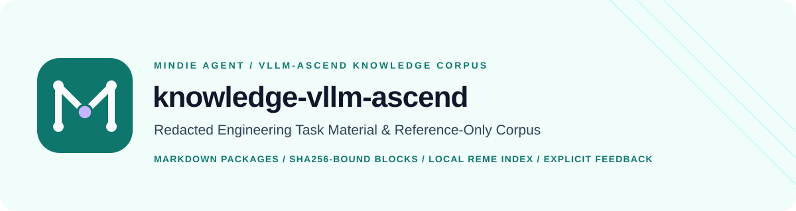

<p align="center">
  
</p>

# MindIE Knowledge — vLLM-Ascend Public Corpus

[中文](../README.md) | English

**Curated Public Markdown Engineering Knowledge Packages and Usefulness Feedback for `vLLM-Ascend` Development**

This repository is the canonical public knowledge feed for [MindIE Agent](https://github.com/mindie-agent/mindie-agent) in the `vLLM` / `vLLM-Ascend` domain, synchronized, indexed, and updated through the shared [`mindie-agent/knowledge`](https://github.com/mindie-agent/knowledge) runtime.

---

## Key Features

- **Complete Redacted Engineering Material**: Each task package preserves ordered, deterministically redacted public conversation blocks (`blocks/<block_id>.md`), including troubleshooting steps, unsuccessful hypotheses, corrected conclusions, and applicability conditions—never replacing primary material with LLM-rewritten summaries.
- **Structured Retrieval Navigation (`index.md`)**: Every task package includes a `mindie-material-task/1` manifest (embedding a `mindie-entry/3` header) with block titles, summaries, and task navigation so Agents can inspect the outline first and read specific blocks on demand.
- **Immutable Hash Binding & Fail-Closed Redaction**: Task and block IDs use 64-character lowercase hexadecimal identifiers, and every block's SHA-256 digest is bound in the manifest. All content is validated against `publication-contract.json` and fail-closed redaction gates before publication.
- **Independent Usefulness Feedback (`feedback/*.json`)**: Consuming Agents can record optional `up` / `down` votes (`mindie-feedback/1`) tied to the exact observed revision after real task use.

---

## Repository Layout

```text
knowledge-vllm-ascend/
├── publication-contract.json      # Content schema, validator version, and review bot contract declaration
├── tasks/
│   └── <64-hex-task-id>/          # Complete task knowledge package
│       ├── index.md               # Task manifest (mindie-material-task/1 + mindie-entry/3)
│       ├── blocks/
│       │   └── <64-hex-block-id>.md  # Immutable redacted material block (mindie-material-block/1)
│       └── feedback/              # Optional independent usefulness feedback records (mindie-feedback/1)
│           └── <feedback-id>.json
└── docs/
    ├── README.en.md               # English Homepage
    ├── CONTRIBUTING.en.md         # English Contributing Guide
    ├── package-format.md          # Package Format Specification (Chinese)
    └── package-format.en.md       # Package Format Specification (English)
```

> **Canonical Feed Layout Note**: To remain strictly compatible with deployed `mindie-knowledge` feed validators, only standard metadata filenames (`README.md`, `CONTRIBUTING.md`, `AGENTS.md`, `LICENSE`) are placed at the repository root; English counterparts reside under `docs/`.

---

## Usage

### 1. Automatic Integration via MindIE Agent Plugins (Recommended)

When you install [`mindie-agent-codex`](https://github.com/mindie-agent/mindie-agent-codex) or [`mindie-agent-cc`](https://github.com/mindie-agent/mindie-agent-cc), the plugin automatically synchronizes packages from this repository and maintains a local BM25 and citation index.

### 2. Standalone Sync & Query via `mindie-knowledge` CLI

```bash
# Synchronize the latest vLLM-Ascend public packages to local storage
mindie-knowledge sync --domain vllm-ascend

# Query relevant engineering knowledge and task experience
mindie-knowledge query --domain vllm-ascend --query "AscendHccl timeout or operator accuracy debugging"
```

---

## Documentation & Contributing

- **Package Format Specification**: [English (`docs/package-format.en.md`)](package-format.en.md) · [中文（`docs/package-format.md`）](package-format.md)
- **Contributing Guide**: [English (`docs/CONTRIBUTING.en.md`)](CONTRIBUTING.en.md) · [中文（`CONTRIBUTING.md`）](../CONTRIBUTING.md)
- **Repository Review Bot Contract**: [`mindie-content-review/2`](https://github.com/mindie-agent/knowledge/blob/main/docs/repository-bot-contract.md)
- **Core Design Principles**: [MindIE Agent Nine Design Principles](https://github.com/mindie-agent/mindie-agent/blob/main/docs/design-principles.en.md)
