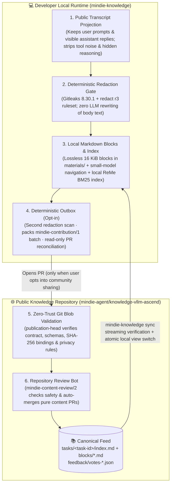

<h1 align="center">MindIE Knowledge · vLLM-Ascend</h1>

<p align="center">
  <strong>Open-Source Troubleshooting Corpus & Real-World Engineering Experience for Ascend NPU and <code>vLLM-Ascend</code></strong><br>
  <sub>Part of <a href="https://github.com/mindie-agent/mindie-agent">MindIE Agent</a> · Powered by <a href="https://github.com/mindie-agent/knowledge"><code>mindie-knowledge</code></a> for sub-second local BM25 retrieval and self-evolving experience loops</sub>
</p>

<p align="center">
  <a href="https://github.com/mindie-agent/mindie-agent"></a>
  <a href="https://github.com/mindie-agent/knowledge"></a>
  <a href="../publication-contract.json"></a>
  <a href="../publication-contract.json"></a>
  <a href="../LICENSE"></a>
</p>

<p align="center">
  <a href="../README.md">中文</a> · <strong>English</strong> · <a href="#-one-sentence-agent-native-install">⚡ One-Sentence Install</a> · <a href="#-why-this-corpus-exists">✨ Why It Exists</a> · <a href="#️-two-layer-loop--redaction-pipeline">🏗️ Architecture</a> · <a href="#-inside-a-real-knowledge-package">📦 Package Anatomy</a> · <a href="package-format.en.md">📐 Format Spec</a> · <a href="CONTRIBUTING.en.md">🤝 Contributing</a>
</p>

---

## ⚡ One-Sentence Agent-Native Install

You never need to manually clone this repository or wire up custom search scripts.

Open **Claude Code**, **OpenAI Codex CLI**, or **Kimi Code**, and send this single sentence to your Agent:

```text
帮我安装一下这个 https://github.com/mindie-agent/mindie-agent
```

Once installed, your Agent automatically connects to the [`mindie-knowledge`](https://github.com/mindie-agent/knowledge) runtime, syncs this corpus (`knowledge-vllm-ascend`) to your machine, and builds a local **BM25 and citation index**. Whenever you hit an Ascend NPU operator failure, HCCL timeout, ACLGraph capture bug, or numerical accuracy mismatch while working on `vllm` / `vllm-ascend`, your Agent can search real troubleshooting records in milliseconds.

<details>
<summary>🤖 <b>AI Agent Auto-Install & Configuration Guide (Instructions for AI Agents)</b></summary>

> **Instructions for AI Agents**:
> 1. **Full MindIE Agent Installation (Recommended — includes automatic sync & retrieval for this corpus)**:
>    Read the main repository homepage at [`https://github.com/mindie-agent/mindie-agent`](https://github.com/mindie-agent/mindie-agent), detect your host client (Claude Code / OpenAI Codex CLI / Kimi Code CLI), and execute the matching plugin installation commands. Once installed, the plugin automatically syncs `mindie-agent/knowledge-vllm-ascend`.
> 2. **Standalone Developer CLI Usage (`mindie-knowledge`)**:
>    If you are running the [`mindie-knowledge`](https://github.com/mindie-agent/knowledge) CLI directly in a standalone environment:
>    ```bash
>    # Install the mindie-knowledge engine
>    python3 -m pip install "mindie-knowledge @ git+https://github.com/mindie-agent/knowledge.git"
>
>    # Sync the latest public packages to your local read-only cache (zero model calls; works even when community sharing is off)
>    mindie-knowledge sync --config domain.json
>
>    # Inspect local corpus health, synced entry counts, and sharing status
>    mindie-knowledge status --config domain.json
>    mindie-knowledge sharing-status --config domain.json
>    ```
> 3. **On-Demand Retrieval & Reading inside Agent Sessions**:
>    - Call `knowledge_query(query="...")` first to search matching material excerpts and task navigation outlines;
>    - Call `knowledge_explain(ref="mindie://vllm-ascend/<task-id>/blocks/<block-id>@<sha256>")` on demand to read the exact unedited block body;
>    - After verifying whether an entry helped in real work, optionally call `knowledge_feedback(ref="mindie://vllm-ascend/<task-id>@<observed-revision>", rating="up"|"down", reason="...")` to record usefulness feedback.

</details>

---

## ✨ Why This Corpus Exists

When developing or debugging `vLLM-Ascend` on Ascend NPUs, the hardest engineering problems rarely have textbook answers. What saves hours is **real troubleshooting evidence**:
- Why does setting `ASCEND_RT_VISIBLE_DEVICES=8` inside a container fail to find a device, and how should logical device visibility be normalized before importing `torch_npu`?
- When verifying `torch_npu.npu_rms_norm` in FP16/BF16, why does computing the CPU reference directly from unrounded FP32 inputs conflate input-cast rounding with operator error?
- Which upstream PRs and CANN operator signatures wire up learnable attention sink in `npu_fused_infer_attention_score_v2`?

Usually, these hard-won lessons either vanish when a chat session closes or get flattened by an LLM into vague summaries that strip out the exact commands, stack traces, failed hypotheses, and hardware caveats.

**`knowledge-vllm-ascend` takes a fundamentally different approach:**

| Dimension | Traditional LLM Summaries / Ad-hoc Wikis ❌ | `knowledge-vllm-ascend` Packages ✅ |
| --- | --- | --- |
| **Fidelity to Source** | Rewritten by LLMs; frequently drops critical flags, versions, or failed attempts | **Lossless Redacted Material**: Every `blocks/<block_id>.md` preserves the actual public conversation turns after deterministic redaction—never rewritten by an LLM |
| **Retrieval Efficiency** | Dumping huge raw logs blows up context windows; vague summaries miss exact symbols | **Two-Stage Reading**: `index.md` provides a lightweight outline and per-block summaries so Agents browse first and open specific blocks on demand |
| **Privacy & Safety** | Engineers hesitate to share because logs contain internal IPs, hostnames, paths, or tokens | **Double Fail-Closed Redaction**: Both local intake and repository CI run Gitleaks + `mindie_knowledge.redact` (`r3`), blocking any sensitive token before publication |
| **Quality Evolution** | Static pages rot silently and mislead future debugging | **Revision-Bound Feedback**: Agents record `up` / `down` votes tied to the exact observed revision (`@<revision>`) after real task verification |

---

## 🏗️ Two-Layer Loop & Redaction Pipeline

This repository serves as the **Public Canonical Feed**, working in tandem with each developer's **Local Experience Loop**:



---

## 📦 Inside a Real Knowledge Package

Every task package lives under `tasks/<64-hex-task-id>/` and combines a **structured navigation manifest** with **immutable, hash-bound material blocks**. Below is an excerpt from a real package in this repository verifying `torch_npu.npu_rms_norm` on Ascend NPU:

### 1. Task Manifest: `tasks/<task_id>/index.md`

`index.md` starts with YAML frontmatter declaring the `mindie-material-task/1` manifest, an embedded `mindie-entry/3` header, and the exact `sha256` digest of every referenced block:

```yaml
---
schema: mindie-material-task/1
task_id: c3f998fdce9eecfbf1171624d6f791d4fc8e4e1b2bf7636f59dfa05e37327815
status: complete
entry:
  schema: mindie-entry/3
  domain: vllm-ascend
  kind: experience
  entry_id: c3f998fdce9eecfbf1171624d6f791d4fc8e4e1b2bf7636f59dfa05e37327815
  conditions:
    torch_npu_version: 2.10.0.post2
    torch_version: 2.10.0+cpu
  title: Bounded Ascend torch_npu RMSNorm validation with dtype-rounded FP16/BF16 references
  summary: A bounded one-logical-device check of torch_npu.npu_rms_norm for shape [7, 2048]...
blocks:
  - block_id: 89bafb72f7ba1dc374e81c1f4c302ab4f20d7fbb1edc0afe568356190bc89f99
    indexed: true
    sha256: 3ab4baa8e56d7ce2f61e54813b70ccdf5fcef8aadee2356d947dc6ae095211b8
    title: Bounded Ascend torch_npu RMSNorm validation with dtype-rounded FP16/BF16 references
    summary: A bounded one-logical-device check of torch_npu.npu_rms_norm...
---
```

### 2. Redacted Material Block: `tasks/<task_id>/blocks/<block_id>.md`

When an Agent needs the exact reproduction code or caveats, it reads `blocks/<block_id>.md`:

```markdown
---
block_id: 89bafb72f7ba1dc374e81c1f4c302ab4f20d7fbb1edc0afe568356190bc89f99
schema: mindie-material-block/1
source_range:
  body_end: 2503
  body_start: 0
---

Problem and background: verify numerical correctness of torch_npu.npu_rms_norm on a real Ascend NPU
for shape [7, 2048], using seed 20260921 and epsilon 1e-6...

Reference and correction method: generate FP32 random tensors, round each input to the tested dtype
on CPU, and compute the reference in FP32 from those rounded values:

x_cpu = x32.to(dtype)
w_cpu = w32.to(dtype)
x = x_cpu.npu()
w = w_cpu.npu()
y, _ = torch_npu.npu_rms_norm(x, w, epsilon=epsilon)
torch.npu.synchronize()
xf = x_cpu.float()
wf = w_cpu.float()
reference = xf * torch.rsqrt((xf * xf).mean(-1, keepdim=True) + epsilon) * wf
```

### 3. Independent Usefulness Feedback: `feedback/votes-<id>.json`

After applying this pattern in a subsequent task, a consuming Agent records a vote bound to the exact revision it observed:

```json
{
  "schema": "mindie-feedback/1",
  "votes": [
    {
      "entry_id": "c3f998fdce9eecfbf1171624d6f791d4fc8e4e1b2bf7636f59dfa05e37327815",
      "rating": "up",
      "reason": "Gives the exact dtype-rounded CPU reference pattern for npu_rms_norm together with the atol=rtol=4*finfo(dtype).eps rule; directly reusable when writing operator accuracy checks.",
      "revision": "937d2219f062ff5b1992faf75d885e68736497a0228032136f29cabc1cfc060b",
      "root_id": "5459766cc74b745fc5069b1042dc25ab7c34db62afc3b339a319c22f7227a1e5",
      "vote_id": "1cc64dc5135c586faa95be0761c20ced6e8318fa8d3b9b174741d041c6f1f4aa"
    }
  ]
}
```

---

## 🗂️ Repository Layout

```text
knowledge-vllm-ascend/
├── publication-contract.json          # Schema versions, pinned validator commit, and review contract
├── tasks/
│   └── <64-hex-task-id>/              # Complete task knowledge package
│       ├── index.md                   # Task manifest & navigation (mindie-material-task/1 + mindie-entry/3)
│       └── blocks/
│           └── <64-hex-block-id>.md   # Immutable redacted material block (mindie-material-block/1)
├── feedback/
│   └── votes-<id>.json                # Independent usefulness feedback records (mindie-feedback/1)
└── docs/
    ├── README.en.md                   # English Homepage (this file)
    ├── CONTRIBUTING.en.md             # English Contributing Guide
    ├── package-format.md              # Package Format Specification (Chinese)
    └── package-format.en.md           # Package Format Specification (English)
```

> [!NOTE]
> **Why is `README.en.md` inside `docs/`?**
> Deployed `mindie-knowledge` feed validators enforce a strict root metadata allowlist (`README.md`, `CONTRIBUTING.md`, `AGENTS.md`, `LICENSE`, `publication-contract.json`). Keeping English documentation and format specifications under `docs/` ensures seamless compatibility across all deployed clients.

---

## 📚 Documentation & Ecosystem Links

| Topic | English | 中文文档 |
| --- | --- | --- |
| **Package Format Specification** | [docs/package-format.en.md](package-format.en.md) | [docs/package-format.md](package-format.md) |
| **Contributing Guide** | [docs/CONTRIBUTING.en.md](CONTRIBUTING.en.md) | [CONTRIBUTING.md](../CONTRIBUTING.md) |
| **Knowledge Runtime Engine (`mindie-knowledge`)** | [README.en.md](https://github.com/mindie-agent/knowledge/blob/main/README.en.md) | [mindie-agent/knowledge](https://github.com/mindie-agent/knowledge) |
| **Repository Review Bot Contract (`mindie-content-review/2`)** | [repository-bot-contract.md](https://github.com/mindie-agent/knowledge/blob/main/docs/repository-bot-contract.md) | [repository-bot-contract.zh.md](https://github.com/mindie-agent/knowledge/blob/main/docs/repository-bot-contract.zh.md) |
| **MindIE Agent Engineering Design Principles** | [design-principles.en.md](https://github.com/mindie-agent/mindie-agent/blob/main/docs/design-principles.en.md) | [design-principles.md](https://github.com/mindie-agent/mindie-agent/blob/main/docs/design-principles.md) |

---

## 📄 License

All public engineering knowledge packages and documentation in this repository are licensed under [Creative Commons Attribution 4.0 International (CC-BY-4.0)](../LICENSE). Knowledge entries are provided for engineering reference only—always verify against your actual hardware and software environment.
