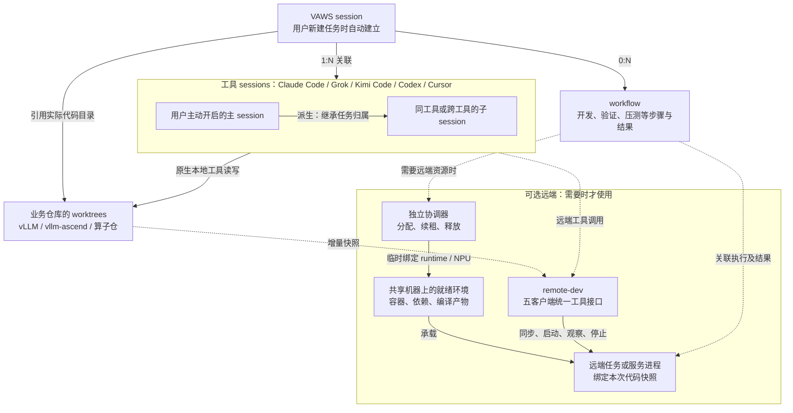

**以 VAWS session 作为稳定的任务身份，不再增加一套重复的任务对象。**

| 对象 | 与 VAWS session 的关系 |
|---|---|
| Agent 工具的 session | 接入这个任务的客户端会话；换 Codex、Claude、Grok 等可以继续关联同一任务 |
| Worktree | 任务使用的实际源码位置；切换客户端不重新创建、不重置 |
| Workflow | 任务中的一次验证、实验或部署流程，记录步骤、结果和恢复位置 |
| 远程 Job / Service | Workflow 启动的实际执行，明确记录进程归属和产物 |
| Machine / Runtime | 按需借用的共享资源；不随客户端会话结束而销毁 |

这样，**换客户端只是换接入者；换机器只是换执行位置；重新拉服务只是开始下一轮执行。任务本身保持连续。**

### 用户只需要表达这些意图

| 用户说 | VAWS 内部完成 |
|---|---|
| “继续刚才的 K3 任务” | 找到对应任务，恢复上下文，核对代码、进程和资源现场 |
| “用 154 跑一下验证” | 选择环境、同步快照、申请资源、启动、续约、收集结果 |
| “先暂停，让别人用卡” | 停止本任务执行，确认释放，保留代码、环境和进度 |
| “换 Claude 接着做” | 建立新客户端关联，恢复任务上下文，不重复启动已有执行 |
| “做完了，收尾” | 清理所属进程、释放资源、复验环境，保留源码和验收证据 |

用户看到“等待资源”“正在同步”“验证中”“已暂停”等业务进度。底层 ID 和状态保留用于排障，但不成为必填操作。

**只有真正需要用户判断的事情才打断**：任务选择有歧义、需要抢占别人的资源、需要删除未提交代码，或者缺少授权。

### 实现重点

这里需要的是一个统一执行器，负责**关联记录、幂等启动、恢复、续约、取消和清理**。Skill 负责理解用户意图并调用它，不能靠给 agent 写一长串提示词来保证生命周期正确。

我已把这些要求和新增验收标准写入 [PR #66](https://github.com/maoxx241/vllm-ascend-workspace/pull/66)，明确标记为待实现。本轮完成了参考实现调研和设计约束整理；代码仍是 `20f536c`，此前验收不能算作这套完整逻辑已经完成。

### user
这个太含糊了，我理解需要有个图来理解，我个人觉得一个用户主动打开的agent工具的窗口除了会新建他自己的工具生命周期以外还会有一个对应的vaws的session，然后vaws-session和工具对应的session应该是1对多的关系，因为这个工具可能会调用自己或者别的agent产生对应的session，然后worktree就是代码仓级别的worktree，他隔离的更多是vaws具体的开发项目代码而不是别的资源，然后remote-dev的工具我理解需要同时适配我前面提到的这些全部工具，这样可以保证快速拉起远端服务，当然如果没有远端资源的话也不影响那所有修改就是在本地就行

### assistant:commentary
我按你这次明确的关系重画：用户主动开启的任务会话建立一个 VAWS session，派生的同工具或跨工具 agent 会话都归到它下面；业务仓库的 worktree 单独负责代码隔离。远端资源是可选分支，没有机器或协调器不可用时，本地开发照常进行。

### assistant:commentary
这里最关键的是两种关系要分开画：工具 session 之间是“谁调用谁”，它们与 VAWS session 之间是“属于哪个开发任务”。子 agent 继承任务归属，不自动再分配 worktree、容器或卡。我会把“没有远端也能完整开展本地开发”一并写进 #66 的设计和验收条件。

### assistant:final_answer
**VAWS session 应该代表“一个开发任务”，其下可以有多个工具 session；worktree 管代码隔离，机器和服务按需关联。** 下面是目标模型，不代表目前已经全部实现。

## 关系图

图中的关键是：**“谁调用谁”与“属于哪个任务”分开记录。** 子 agent 有自己的原生 session，但不因此新建 VAWS session，也不自动再占一套机器、容器或卡。

## 生命周期按这些规则走

| 用户行为或事件 | 系统内部行为 |
|---|---|
| 主动新建独立任务 | 创建原生主 session，并自动建立 VAWS session；不申请远端资源 |
| 派生子 agent、跨工具接着做 | 新增工具 session，继承同一个 VAWS session |
| 恢复原任务 | 恢复原 VAWS session，核对已有代码、执行和资源状态 |
| 本地修改代码 | 使用实际业务仓库的 worktree；需要独立代码分支时才另建 worktree |
| 没有机器、没有空闲卡、协调器离线 | 本地开发照常进行，只让依赖远端的步骤等待或明确报错 |
| 关闭一个工具窗口 | 结束或断开这个工具 session，不等于整个任务结束，也不能据此释放卡 |
| 完成或取消任务 | 自动停止已确认归属的执行、核实退出、释放资源；默认保留业务代码和结果 |

**远端执行的调用顺序**由任务适配层负责：

**复用就绪环境 → 同步选定快照 → 验证环境与产物 → 申请卡 → 启动新服务 → 记录结果 → 确认退出并释放。**

这里复用的是容器、依赖和兼容的编译产物；开发修改后重新启动模型进程，不依赖模型服务常驻来提速。:codex-annotation{index="1"}

用户只需要说“继续修改”“跑一下验证”“换到另一台机器”，无需操作下面的 session ID、租约或清理顺序。

我已把这张关系图及对应验收条件更新到 [PR #66](https://github.com/maoxx241/vllm-ascend-workspace/pull/66)。**本轮更新的是设计；自动关联、子会话继承、本地优先和完整生命周期实现仍待完成，不能用已有五客户端 MCP 测试代替这些验收。**

### user
workflow实际上是我打错了（一开始我想说的是worktree），不过我感觉这个看起来好像差不多，按照这个思路实现一版吧，然后实机确认用5.6luna用vaws并行3个任务没有任何影响

### assistant:commentary
我会按这个模型实现，并把 workflow 当作普通执行记录，不另造工作流系统。完成后用 5.6 luna 启动 3 个通过 VAWS 管理的并行任务，在实机验证代码、资源和清理互不影响；先确认 153/154 的当前占用，避开高优先级任务。

### assistant:commentary
我会复用仓库里的 session-management、remote-code-parity 和 remote-dev，再补任务关联与自动执行这一层；相关 skill 也会一起更新。第一版不要求创建 VAWS 仓库副本，直接关联实际业务 worktree，先保证本地任务能独立运行。

### assistant:commentary
五个客户端都有可用的会话钩子，但字段和触发时机不同。我正在按实际接口做适配：主会话自动登记，子会话记录父子关系；不会用“同一个目录”或“最新聊天记录”来猜任务归属，这样同目录里的独立任务也不会被串在一起。

### user
实际上我理解除非用户主动说了当前这个主动打开的窗口的vaws的任务归属，不然所有用户新启动的session都是新的vaws session

### assistant:commentary
按这个更严格的规则来：**用户主动启动的窗口或会话默认都创建新的 VAWS session**，不会因为目录、分支或恢复了历史聊天就自动归入旧任务。只有用户明确指定 VAWS 归属，或已有任务内部派生子 agent 时，才关联到已有 VAWS session。我会同步修改实现和验收条件。

### user

# Response annotations:
Each item contains text selected from an earlier Codex response and may include a user comment. Treat items as Annotation 1, Annotation 2, and so on in array order. Use every selection as context and address every comment. For every annotation you address, include its inline directive `:codex-annotation{index="N"}`, where N is its one-based array position (for example, `:codex-annotation{index="1"}`). Do not use unstructured annotation labels.
<response-annotations>
[{"text":"恢复了历史聊天"}]
</response-annotations>

## My request:
恢复历史聊天怎么理解？你是指resume吗？但是resume的话应该也是在之前的那个session吧

### assistant:commentary
对，我指的是 `resume`，刚才那句话把范围说大了。**resume 是继续原来的工具 session，也应继续原来的 VAWS session。** :codex-annotation{index="1"}

规则应是：新建工具 session → 新 VAWS session；resume 原工具 session → 原 VAWS session；任务内部派生子 agent，或用户明确指定归属 → 关联指定的 VAWS session。我会据此修正正在写的实现和测试。

### assistant:commentary
本地任务身份和子会话关联的代码已开始落地，规则已修正为 resume 沿用原任务。远端这部分会加一个启动关口：先登记并确认进程归属、激活租约，再让服务代码运行；续租和回收由协调器负责，不依赖 agent 窗口一直开着。

### assistant:commentary
这里按“工具 session 的身份”来区分：`resume` 保留原 VAWS session；新聊天才创建新 VAWS session，即使它们在同一个目录。这个边界会直接写进回归测试，不靠聊天内容或窗口位置判断。

### user
<codex_delegation>
  <source_thread_id>01a04661-c94d-7112-bbf0-788f48502cdd</source_thread_id>
  <input>确认：本 MRV2 任务从未使用 154，也未在 codex-k3-pr14454-154 启动任何服务；当前没有 NPU 占用或预留需求。我们的实机验证仅在 153 的 codex-k3-pr14454-153，最后一组服务 PGID 840245 已在验证结束后清理。后续仅做了独立目录内的 CPU 测试和 PR 文档修改，没有重启推理服务。因此你看到的 154 EngineCore/Worker_DP 不属于本任务；我没有其当前归属证据，也不据此授权停止。请继续按 PID/PGID、启动参数及日志核对实际归属。你的独立 CPU 路径与本任务没有已知冲突；不需要为本任务预留 154。</input>
</codex_delegation>

### user
现在先别占用机器

### assistant:commentary
收到，153/154 都先不占用，暂停远端测试和三任务并行验收。本轮只做了只读探测，没有启动远端任务或服务；接下来只继续本地代码和文档工作。

### assistant:commentary
远端验收已暂停。本地审查还发现一个需要处理的边界：服务启动时可能先做 CPU 初始化，尚未显示 NPU 占用，因此不能仅凭“卡当前空闲”回收租约。我在补进程归属保护，但这部分尚未运行验证。

### assistant:commentary
本地规则、客户端配置脚本和回归用例已补上，重点覆盖新建、resume、子 agent 继承，以及断线后的租约处理。现在只检查语法和差异；五客户端新生命周期验证、153/154 实机验收仍未执行，也不会用之前的结果代替。

### assistant:commentary
我会先把新增实现保留在本地，暂不推送；PR #66 的说明会更新为“实现中、实机验收暂停”。`resume` 沿用原 VAWS session，以及“不另建 workflow 引擎”这两点也会同步写清楚，避免把旧版本的验证结果算到新功能上。

### assistant:final_answer
已暂停 153/154 的实机验收，本轮没有启动远端任务或服务。

新增实现保留在本地，仅完成静态检查，尚未提交；[PR #66](https://github.com/maoxx241/vllm-ascend-workspace/pull/66) 的说明已同步更新。

`resume` 沿用原工具 session 和原 VAWS session，不创建新任务。:codex-annotation{index="1"}

### user
机器释放了，你可以用了

### assistant:commentary
收到，我恢复实机验收。先只读确认 154 的占用和已有环境，再跑回归与五客户端验证，最后用 5.6 luna 做三个 VAWS 任务的并行验证；153 先不动。

### assistant:commentary
154 上还留着一组连接 153 的双机 K3 服务，占满了 16 张卡。我已把进程组和日志路径发给“kimi 合主线”任务核对；在它确认清理前，先用独立目录跑 CPU 回归，不动这组服务。

### user
cursor用cursor-agent，我已经登录过了，153用别的agent工具也测试一下不要让机器闲着

### assistant:commentary
好，Cursor 改用已登录的 `cursor-agent`。我会让三个 5.6 luna 验收 agent 并行推进五种客户端的真实调用，也在 153 做隔离测试；NPU 作业仍先确认旧服务已退出，再通过 VAWS 租约启动。

### user
<codex_delegation>
  <source_thread_id>01a00f42-c273-7532-acf4-75e77f0a9267</source_thread_id>
  <input>本任务现在只在本地整理四机定位交接包，不再向153/154发推理，也不需要保留154的K3服务；我尚未清理它。你探测到的日志路径属于本任务的K3验证目录。PGID 456098与我此前记录的旧PGID不同，请以你刚读取的容器、完整命令行、DP rank1/连接153及进程组成员为准。你已有用户“机器释放了”的授权，可在完成这些归属核对后停止154这一明确的K3服务组再用卡；不要据旧PID或泛化pkill清理其他服务。本任务不会再启动或占用154，也不会改共享源码/依赖。</input>
</codex_delegation>

### user
<codex_delegation>
  <source_thread_id>01a00f42-c273-7532-acf4-75e77f0a9267</source_thread_id>
  <input>收到。153的本次K3验证也已结束，不需要保留DP rank0服务；本任务已取回需要的日志/数据，目前仅在本地校验和压缩交接包，不再使用153/154。你已有用户释放机器并用于验收的授权，若发现153仍有 codex-k3-pr14454-153 内、日志位于 codex-pr14454-merged-acceptance-20260828/merged-quarot-gqa-32k-b8192-cg16/ 的DP rank0服务，可按与154同样的方法重新核对实际PID/PGID、容器及全部组成员后清理该明确组。请不要沿用我早期记录的PID，也不要清理其他任务。我的取证不会再发生成请求。</input>
</codex_delegation>

### user
<codex_delegation>
  <source_thread_id>01a047e3-6c16-7a63-88ba-75de32c0a3e4</source_thread_id>
  <input>验收报告（client-b）：已读 AGENTS、session-management/remote-toolbox 规则。客户端版本 Kimi Code 0.38.0；Cursor Agent 2026.08.25-3e8eec8。

Kimi 真实新 native session：session_189a0787-7ccd-429c-b50f-54c16715a04d，hook 生成 context=<redacted:local-path:579089ea1271> 结果 task/session=vaws-0c10469361724e19a028b658a220f4ed，attachment_id=bc276093150f30127bbb02afb3268b608931549a97248f43b59e8bb3def35b5a，state=open/attached，sources 被归一到实际 worktree <redacted:local-path:b9bb4a0ded6a> Kimi native id 两次 resume，第二次返回同一 context/task（resumed_at 更新），因此 new/resume identity 保持成立。

