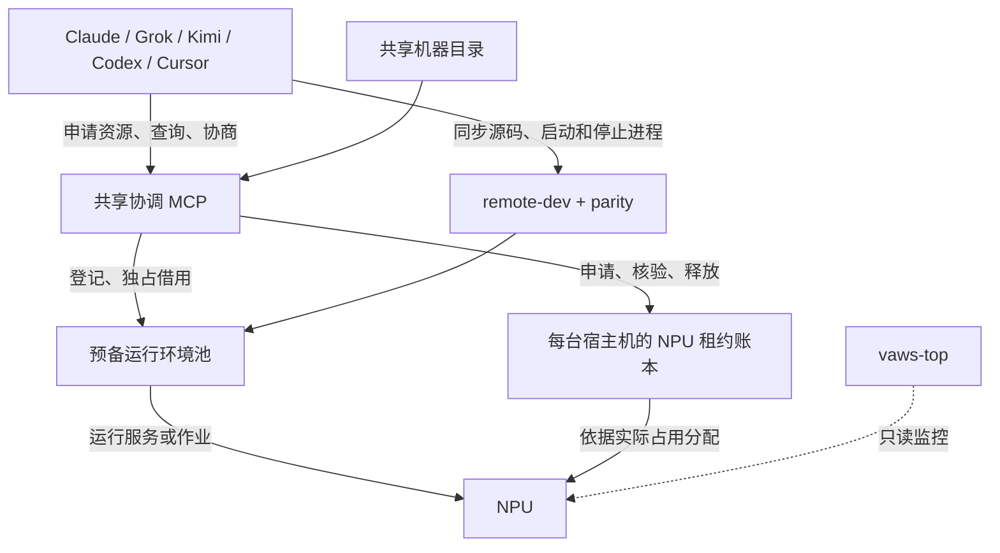
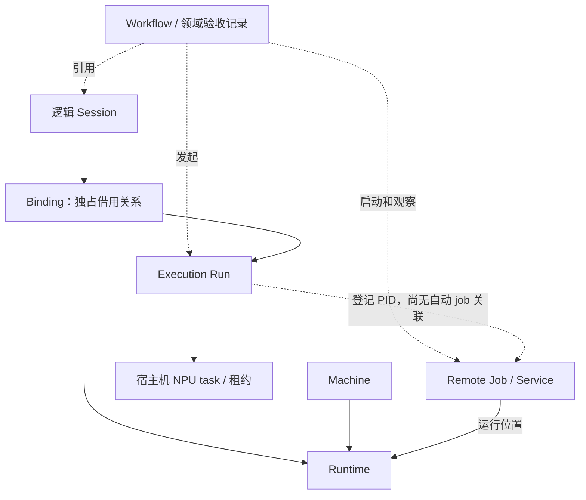

### assistant:commentary
关键是把“占用运行环境”和“占用 NPU”分开：一个任务可以保留容器、源码和编译产物，但只在执行时租卡。MCP 负责协调和核验，服务的启动、停止仍由 agent 通过 remote-dev 执行；关闭对话不会自动杀服务或释放所有资源。


### assistant:final_answer
按 **PR #66 当前实现 `20f536c`**，整体可以概括为：

**共享 MCP 管资源分配与协调，remote-dev 管实际操作；运行环境可以长期复用，NPU 按每次执行租用。** PR 目前还没合入 main。

## 1. 整体结构



这里有三个职责边界：

- **协调 MCP**：谁借用了哪个环境、谁申请哪些卡、排队和消息。
- **remote-dev / parity**：文件同步、命令执行、服务启动停止、日志和产物。
- **vaws-top**：观察机器状态，不参与资源分配；协调器不依赖它。

协调 MCP 是一个共享的后台进程，只需要 CPU。宿主机上的协调逻辑目前通过 SSH 按请求执行，读写共享 SQLite 账本，**不需要每台机器再部署一个常驻协调 daemon**。

## 2. 资源和任务之间是什么关系

| 对象 | 管什么 | 生命周期 |
|---|---|---|
| **Session** | 任务身份、所属客户端身份、实际业务源码路径 | 可以长期存在，不自动绑定机器 |
| **Runtime** | 已准备的容器、运行目录、环境、原生产物、声明的服务端口 | 跨任务复用 |
| **Binding** | 某个 Session 对一个 Runtime 的独占借用 | 从 checkout 到主动 return |
| **Run** | 一次执行的代码快照、构建身份、NPU 租约、PID | 每轮执行独立 |
| **机器目录** | 主机和连接入口 | 只负责发现，不代表资源已经分配 |

最关键的是：

> **释放 NPU，不需要归还运行环境；归还运行环境，也不需要删除容器和编译产物。**

所以任务 A 可以保留自己的环境继续改代码，把卡先让给任务 B；下一轮 A 再申请卡。

同一个 Binding 可以连续运行多轮，但同一时刻只允许一个尚未结束的 Run。[对应实现](<redacted:local-path:3deb87187b6a>:88)

## 3. 环境与执行的生命周期

### 环境准备：提前做

```text
准备容器、依赖、原生产物
    → 校验并注册 ready
    → 任务借用 bound
    → 任务归还 needs_repair
    → 清理、复验后重新 ready
```

这里 `needs_repair` 也用于“归还后待检查”，不一定意味着环境坏了。

环境按精确的 `profile_key` 匹配，包含镜像、CANN、驱动、Python ABI、torch-npu、vLLM、VA、编译和启动配置等；原生产物另有 `build_key` 和完整文件哈希。

**池里已有匹配环境时，checkout 不创建 Docker、不安装依赖、不编译。没有匹配项则明确返回 miss，当前不会自动建环境或补池。**

### 一次执行：用卡时才做

```text
pending → queued → granted → starting → active → released
```

实际顺序是：

1. Agent 打开逻辑 Session，借用匹配的 Runtime。
2. 把指定源码快照落到运行目录，核对原生产物。
3. 申请指定设备或指定数量的 NPU。
4. 获批后，启动前再次核对源码、环境和实际卡占用。
5. Agent 通过 remote-dev 启动服务，马上登记 PID，并持续续约。
6. 执行完成后停止自己的进程，再申请释放；主动释放默认经过两次空闲采样。
7. 继续开发就保留 Binding；整个任务结束才归还 Runtime。

**`active` 只表示执行已登记，不表示模型已经 ready。** 权重加载、图捕获、所有 rank 就绪和真实请求，仍由服务/验收流程判断。[租约状态机](<redacted:local-path:83d6f4042a92>:788)

## 4. 修改代码时怎么加速

运行中修改本地代码，watcher 会把变化同步到远端**暂存区**，不会改正在运行的源码。

下一轮：

```text
停止旧服务、释放租约
    → 落地新快照
    → 检查 native/dependency 指纹
    → 申请资源、启动新服务
```

- 指纹没变：复用已有编译产物。
- 原生代码或依赖变了：恢复匹配的缓存包，或者显式构建后重新校验。
- CANN 等环境身份变了：需要匹配新的环境配置。

因此省掉的是重复准备环境和无意义的编译；**修改后仍重新启动模型服务，模型加载本身不会被省掉**。[同步机制](<redacted:local-path:d594de9d7082>:16)

## 5. 调度、协商和异常处理

**资源分配**

目前按 NPU 设备 ID 分配，支持指定设备、数量、优先级和排队期限。排序是优先级优先、同优先级按提交顺序；不自动抢占正在运行的任务，也没有小任务绕过队首大任务的回填调度。

**任务协商**

Agent 可以查看占用者、发消息、回复和读取事件。例如你说“让 K3 优先用这几张卡”，Agent 可以转成资源请求并联系当前占用者。但对方回复“可以”不会直接释放卡，仍需实际停止并确认释放。事件需要客户端读取，不能自动唤醒一个暂停的 Agent。

**掉线和崩溃**

- 心跳过期，设备仍忙或状态未知：保留占用，标记异常，不自动 kill。
- 观察到设备已空闲：可以回收租约。
- MCP 重启：恢复持久化的任务和绑定记录，再核对宿主机账本。
- 宿主机临时账本丢失、epoch 改变：进入不确定状态，需要核对，不能当作全部空闲。
- 关闭 Codex/Claude 对话：**不等于结束 Run、归还 Runtime**；目前没有完整的会话退出自动回收。

## 6. 当前还没统一的部分

这版已经具备上述协调流程，但仍有明确边界：

- **旧 managed-session 路径仍然存在**，其本地 `leases.json` 没有变成跨仓库分配器；新池流程统一走 MCP 和宿主机账本。
- 独立 clone、不同客户端必须连接**同一个协调器**，不能各自启动一套数据库管理同一资源池。
- 没有 CPU、内存、磁盘配额管理，也没有阻止任意 SSH 操作绕过租约的系统级隔离。
- 尚无跨多机原子分配、自动清理补池、完整 K3 四机服务生命周期。

另外，**154 的验收实例已经停掉，并非已经部署了一套长期运行的生产环境池**。当前完成的是实现与验收；长期使用还需要固定协调器部署位置、登记可复用环境并让各客户端接入。


### user
workflow、session，远程任务、机器这些东西的生命周期以及调用关系呢？


### assistant:commentary
我再把这些对象串起来，重点区分 workflow、逻辑 session、远程 job 和执行租约各自管什么，以及哪些关系是代码里已经建立的、哪些还靠 agent 串联。


### assistant:commentary
代码里确实还有一段没自动接起来：workflow 的验收记录、协调器的 Run、remote-dev 的 job 各有自己的 ID 和状态。现在主要由 agent/skill 按顺序调用；job 结束不会自动释放租约，workflow 取消也没有统一的子任务清理机制。另外，旧 managed session 和新 MCP 逻辑 session 是两种不同对象。


### assistant:final_answer
这次从**“谁引用谁、谁创建谁、谁结束谁”**来讲。一个需要先明确的现状是：

**PR #66 已经建立资源和执行租约的生命周期，但 Workflow、Session、远程 Job 还没有全部接成自动托管的一条链。部分调用和收尾仍由 agent/skill 串联。**

## 1. 各个对象分别是什么

| 对象 | 职责 | 生命周期 |
|---|---|---|
| **Machine** | 提供宿主机、Docker、NPU 和连接入口 | 接入 → 验证/维修 → 移出管理；独立于开发任务 |
| **Runtime** | 机器上的已准备容器、环境、源码目录和编译产物 | 准备 → ready → 被借用 → 归还待复验 → ready |
| **Session** | 开发任务上下文：身份、实际业务源码路径 | 新 MCP 中是持久化记录，目前没有完整的 close/自动清理接口 |
| **Workflow** | 完成一个目标的步骤，如性能对比、Profiling、PD 部署 | 计划 → 执行 → 成功/失败/证据不足/取消 |
| **Execution Run** | 一轮执行对应的快照、环境和 NPU 租约 | 申请 → 排队 → 获批 → 启动 → 活跃 → 释放 |
| **Remote Job / Service** | 远端实际运行的命令或服务进程 | 启动 → 运行 → 退出/失败/超时/停止 |

**Workflow 是“要完成什么”，Session 是“属于哪个开发上下文”，Run 是“这一轮借哪些资源”，Job 是“远端实际跑什么”。**

## 2. 它们的关系

实线表示已有明确记录关系；虚线表示目前主要由调用方关联。



几个具体关系：

- 一台 Machine 可以提供多个 Runtime。
- 一个 Session 可以借用 Runtime；**不是创建 Session 就必须创建机器或容器**。
- 一个 Binding 可以运行多轮 Run，但同一时刻只允许一个未结束的执行。
- 一个 Workflow 可以包含多轮实验；某些领域流程也可以引用多个 Session，例如现有 PD 的 Session Group。
- **MCP 的 Run 与 remote-dev 的 Job，目前没有自动建立完整的持久化父子关系。**

## 3. 一次 Workflow 的实际调用顺序

以“修改 K3 代码，然后跑一次验证”为例，新池模式下是：

```text
Agent / Workflow
  │
  ├─ session_open
  │    记录任务身份和业务源码路径
  │
  ├─ runtime_checkout
  │    借用匹配环境，得到 binding_id 和远端 endpoint
  │
  ├─ parity
  │    将待执行快照落到运行目录
  │
  ├─ execution_request → poll → preflight
  │    固定快照和构建身份，申请并核对 NPU
  │
  ├─ remote-dev 启动命令/服务
  │    获得 job_id，确认实际服务 PID
  │
  ├─ execution_control(activate / heartbeat)
  │    登记执行并续约
  │
  ├─ 观察日志、等待就绪、执行请求、收集结果
  │
  ├─ 停止本轮进程 → execution_control(release)
  │    确认设备空闲后释放租约
  │
  └─ 写 Workflow 结果
       继续开发可保留 Runtime；整个任务结束再 runtime_return
```

**现在执行这段顺序的是 agent 或具体脚本，并不是向 MCP 提交一个 Workflow 后，它就自动完成全部步骤。**

已有部分领域脚本会自动编排，例如 PD 脚本有启动顺序和失败回滚；但它目前仍调用旧的 `serve_start --session-id`，没有自动切换到新池模式。[PD 调用实现](<redacted:local-path:57746ef14507>:210)

## 4. “结束”分别意味着什么

这是生命周期里最容易混淆的部分：

| 事件 | 实际含义 | 不会自动意味着 |
|---|---|---|
| Job `succeeded` | 命令退出码为 0 | 模型正确、Workflow 通过、租约释放 |
| 服务停止 | 服务进程停止 | Runtime 归还、容器删除 |
| Run `released` | NPU 租约已释放 | Workflow 验收通过 |
| Workflow `failed/cancelled` | 流程失败或取消 | 所有远端子进程已经清理 |
| Runtime `returned` | 独占借用结束，进入待复验 | 容器和编译产物被销毁 |
| 关闭客户端对话 | Agent 不再继续执行 | Session、Job、租约自动结束 |

Workflow 的 Run Manifest 有自己的验收状态；协调器导出的执行记录不会因为释放卡就变成 `passed`。[验收状态定义](<redacted:local-path:a64473aaffbd>:27)

远程后台 Job 则通过独立 runner 和状态文件运行，可以在 SSH 调用结束后继续执行，**不会自动向协调器报告结束或释放卡**。[Job 实现](<redacted:local-path:c9ef9db42ae0>:47)

## 5. 还要特别区分两种 Session

目前仓库里两条路径同时存在：

**旧 managed session**

```text
session_create
  → 本地 worktree
  → 专属远端容器
  → 本地端口/NPU leases
  → serving / benchmark / profiling
```

**新 MCP logical session**

```text
session_open
  → 按需 checkout 已准备 Runtime
  → 每轮申请执行租约
  → remote-dev 执行
```

它们不是同一种记录，**不能把新 Binding ID 当成旧 `--session-id` 使用**。客户端的 Codex/Claude 对话 ID，也不会天然等于这两种 Session 的完整生命周期。[两种模式的说明](<redacted:local-path:35b21c4fdad2>:15)

## 6. 当前完整生命周期还缺什么

主要缺的是上下层衔接：

1. **统一关联身份**：Workflow 的领域 `run_id`、MCP `run_id`、宿主机 `task_id`、remote-dev `job_id` 尚未全部自动关联。
2. **统一取消和清理**：取消 Workflow 后，自动停止其全部子任务、确认 worker 退出、释放租约，再决定是否归还 Runtime。
3. **断线恢复**：新 Agent 接手后，能从一个 Workflow 入口恢复所有执行状态和待完成清理。
4. **机器下线流程**：停止新分配、等待或协调已有执行结束，再移除环境。旧机器移除入口尚未接入新池的统一排空机制。

另外，当前 `remote_job_stop` 只对记录的 PID 发信号，不能据此保证所有派生 worker 都停止；最终仍必须核验实际进程和 NPU 占用。[停止实现](<redacted:local-path:c9ef9db42ae0>:395)

**因此，#66 当前完成的是共享资源与执行基础层。要达到“Agent 提交 Workflow 后，启动、恢复、取消、收尾都自动完成”的体验，下一步应补统一执行编排和回收链。**


### user
我理解整体需要做成一个完整的逻辑，vaws-session、对应的agent工具的session，机器，worktree，远端的服务这些本身是需要有一定关联和解耦的机器的，我看grok已经有一个resume-codex以及resum-claude这种的skill了感觉可以参考一下（如果能看到实现的话），然后这些东西必须对用户是屏蔽实现的，也就是用户是不应该感知到下面的这些生命周期的


### assistant:commentary
我会先找一下 Grok 的 `resume-codex` / `resume-claude` 实现，再对照 VAWS 现有的会话和资源记录，设计统一的关联、恢复与清理流程。目标是让用户只表达“继续任务、运行验证、暂停”，底层生命周期由工具处理；涉及抢占他人资源或破坏性清理时，仍保留明确授权。


### assistant:commentary
找到了完整实现：两个 skill 都调用同一个 `session_reader.py`。它做的是“读取旧会话 → 提取任务上下文 → 核对当前现场 → 在新 agent 中继续”，不会接管旧进程或自动继承资源权限。

这个思路适合参考：让稳定的 VAWS 任务身份关联多个客户端会话，再把 worktree、workflow、运行环境和远端进程挂到这个任务上。用户看到任务进度；内部的恢复、续约、停止和回收由统一入口处理。


### assistant:final_answer
是，**用户入口应该是“任务”，底层对象的关联和生命周期由 VAWS 维护。** 不能要求用户记住 session、binding、job、租约之间的操作顺序。

### Grok 的实现看到了

两个 skill 都调用同一个 [session_reader.py](<redacted:local-path:9c9e84d6c8b8>)，流程是：

**读取旧会话 → 提取目标、进度、停止位置 → 核对当前现场 → 在新 agent 中继续。**

它处理的是上下文恢复，不会自动接管旧进程、容器或资源权限。这一点要保留。[恢复规则](<redacted:local-path:c439fa084db9>)

### 统一后的逻辑应当这样组织

