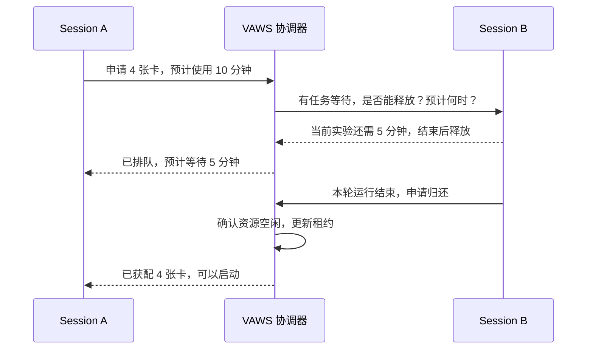

### user
看下66号pr，然后有个问题是你看下这个pr是干什么的，对于我们当前的项目是否有帮助，以及根据codex://threads/01a0428d-fb1a-7612-90c2-6d6ea8a2dcf1这个session反应的问题，这个pr是否有帮助

### assistant:commentary
我先看当前仓库的 #66 PR 和你给的任务记录，再对照它的改动与那个任务暴露的问题，判断它能解决哪些问题、还有哪些缺口。

### assistant:commentary
#66 的范围比标题看起来大：有 95 个文件，既修 session、租约和启动流程，也新增 benchmark 对比和 profiling 分析。它确实涉及你上次提到的部分问题；我会重点核对“多任务隔离是否补全”和“工具仓与业务仓是否解耦”，不只看 PR 描述。

### assistant:commentary
已确认两点：PR 把主要执行流程改为按 session 管理，对避免同一工作区内的任务串用服务有帮助；但它没有实现外部业务仓库绑定，复用 worktree 时仍会更新 submodule。另发现回收租约的判断可能过宽：SSH 失败会被当成容器已退出，我在核对这条路径是否可能误释放仍在使用的卡。

### assistant:commentary
对照结果已经清楚：这次改动能改善受管单机任务的可靠性，但跨工作区调度、停服务后归还 NPU 租约、K3 四机联合启动和真实请求就绪检查都还没补上。合并前还应处理两类风险：误回收活跃任务的租约，以及复用 worktree 时重置子仓库分支。

### assistant:final_answer
**有帮助，但主要是在修好现有 VAWS 工作流；你那个任务提出的几个核心架构问题，还没有解决。** 而且我发现了几处合并前应修的安全风险。

我核对的是 [#66](https://github.com/maoxx241/vllm-ascend-workspace/pull/66) 最新提交 `065c99f`，以及任务「检索 K3 远程部署问题」的原始讨论。

## 1. 这个 PR 在做什么？

它有 95 个文件改动，主要包含四部分：

- **让失败明确暴露**：依赖检查、NPU 探测、任务状态读取失败时，不再假装成功；旧服务停不掉时拒绝重复启动。
- **强化 session 工作流**：serving、benchmark、profiling 改为按 session 执行，可以从当前 worktree 自动识别目标；增加租约回收、子仓库命名分支和 `session_diff`。
- **减少重复准备工作**：复用 SSH 连接，合并就绪轮询；纯 Python 修改优先更新源码，减少不必要的安装重编。
- **扩展实验工具**：新增 baseline/PR 多版本 benchmark，以及模型配置、算子 shape、硬件峰值辅助的 profiling 分析。[PR 说明](https://github.com/maoxx241/vllm-ascend-workspace/pull/66)

**对我们频繁改代码、远端验证、对比 PR 性能的工作方式，这些都有实际价值。** 但主要收益是开发效率和运行可靠性，不是直接修复 K3 模型或算子。

另外，主要领域命令移除了旧的 `--machine` 入口，现有调用需要迁移到 session，不能当作完全兼容的升级。

## 2. 对上次任务的问题，覆盖了多少？

| 上次提出的问题 | #66 的作用 |
|---|---|
| 部署失败被掩盖、反复无效重试 | **直接改善**：更多检查会明确失败 |
| 同一工作区内多个任务串用服务、状态或端口 | **有所改善**：主要执行流程统一按 session 管理 |
| 跨工作区、跨客户端抢卡，以及大任务挡住小任务 | **没有解决**：本地租约仍按工作区保存，协调器仍是严格队头放行。[调度代码](https://github.com/maoxx241/vllm-ascend-workspace/blob/065c99fff39b82491892f89e063eceb322a148d2/.agents/lib/vaws_npu_coordination.py#L754) |
| 停服务后仍长期占着 NPU 租约 | **没有解决**：`serve_stop` 仍只释放服务端口。[停止代码](https://github.com/maoxx241/vllm-ascend-workspace/blob/065c99fff39b82491892f89e063eceb322a148d2/.agents/skills/vllm-ascend-serving/scripts/serve_stop.py#L146) |
| submodule 对 agent 操作不友好 | **部分改善**：命名分支和统一 diff 更方便，但父仓库、gitlink、递归子仓库的复杂度仍在 |
| 工具仓与业务仓解耦，避免维护两份 VA | **没有实现**：parity 仍从 session 的 VAWS worktree 取源码，没有新增独立绑定实际 VA/vLLM 工作树的完整流程。[源码入口](https://github.com/maoxx241/vllm-ascend-workspace/blob/065c99fff39b82491892f89e063eceb322a148d2/.agents/skills/remote-code-parity/scripts/parity_sync.py#L97) |
| K3 四机联合启动、残留清理、真实请求验收 | **仍有主要缺口**：标准 serving 仍是单机，默认 300 秒，就绪仍看进程、health 和 models。[就绪检查](https://github.com/maoxx241/vllm-ascend-workspace/blob/065c99fff39b82491892f89e063eceb322a148d2/.agents/skills/vllm-ascend-serving/scripts/serve_start.py#L437) |

所以，你之前担心的“工具仓里一份 VA，业务目录又一份 VA，需要不断同步”，**并不会因为这个 PR 自动消失**。它是在改善现有 submodule 模式。

## 3. 合并前需要处理的风险

以下是源码审查发现，未做远端复现：

1. **SSH 失败会误触发租约回收。**  
   GC 除了 Python 层超时，几乎把所有 SSH 非零退出都判为容器死亡，再释放租约。认证失败、网络故障或者容器 sshd 故障，并不能证明 NPU 任务已退出。[对应代码](https://github.com/maoxx241/vllm-ascend-workspace/blob/065c99fff39b82491892f89e063eceb322a148d2/.agents/skills/session-management/scripts/session_gc.py#L62)

2. **只删除本地 worktree，也可能释放仍在使用的远端资源。**  
   `session_remove --remove-worktree` 的成功判定没有要求服务停止成功，却可以标记 `removed`；新增的状态钩子随后自动释放全部租约。[删除判定](https://github.com/maoxx241/vllm-ascend-workspace/blob/065c99fff39b82491892f89e063eceb322a148d2/.agents/skills/session-management/scripts/session_remove.py#L218)、[自动释放](https://github.com/maoxx241/vllm-ascend-workspace/blob/065c99fff39b82491892f89e063eceb322a148d2/.agents/lib/vaws_session_state.py#L610)

3. **复用 worktree 仍可能重置子仓库分支。**  
   已有工作树路径先执行递归 `submodule update`，然后新增 `checkout -B`。如果子仓已经提交修改、父仓 gitlink 尚未更新，这条路径可能把 session 分支移回旧提交，让已有提交脱离该分支。[对应代码](https://github.com/maoxx241/vllm-ascend-workspace/blob/065c99fff39b82491892f89e063eceb322a148d2/.agents/skills/session-management/scripts/session_create.py#L321)

**我的建议：吸收这些基础修复，但先修上述风险；profiling 的大块扩展可以单独评审。** 后续仍需补“直接绑定业务工作树、跨工作区资源协调、按运行归还资源、K3 四机生命周期”。

目前三个 GitHub 检查通过；PR 描述中的 131 双 session 实测，我没有核验原始日志，不能据此认定跨工作区或 K3 四机问题已经解决。本次未修改工作区代码或远端服务。

### user
我理解这几个问题需要修复，然后另一个问题是，这个修改主要是为了当前仓库支持多任务并行吧，然后这个核心的功能是ok的么？

### assistant:commentary
对，这个 PR 的一个核心目标是把主要执行流程统一到 session，改善当前仓库里的多任务并行。我再沿“识别 session → 分配资源 → 同步代码 → 启停服务 → 保存结果”核对一遍，区分正常路径是否连通，以及哪些结论已有实测支持。

### assistant:final_answer
**你的理解基本对：它的重要目标，就是让当前 VAWS 仓库里的多个任务，统一通过各自的 session 并行工作。**

而且要收窄验收范围：**跨工作区调度、业务仓解耦、K3 四机支持，不是这次必须一起完成的条件。**

### 核心方案是否成立？

**成立，正常路径的主要环节已经接起来了：**

- 每个任务有自己的 worktree、容器和 session。
- 代码同步、服务启停、benchmark 都沿同一个 session 找目标。
- 申请 NPU 和端口时，共享租约表通过锁防止重复分配。
- 服务状态、操作锁和 benchmark 结果按 session 保存。[资源分配实现](https://github.com/maoxx241/vllm-ascend-workspace/blob/065c99fff39b82491892f89e063eceb322a148d2/.agents/lib/vaws_session_state.py#L290)、[benchmark 目标固定](https://github.com/maoxx241/vllm-ascend-workspace/blob/065c99fff39b82491892f89e063eceb322a148d2/.agents/skills/vllm-ascend-benchmark/scripts/_common.py#L315)

所以，**“同一个基础仓库统一管理、每个任务独立 session、提前申请互不重叠的卡”这个使用方式，设计上是合理的。**

### 但当前实现还不能无条件说 OK

除了前面三个问题，我这次核对发现一个直接关系到并行安全的缺口：

**没有 NPU 租约的 session，仍然可以尝试启动 NPU 服务。**

创建 session 时允许不申请卡，这对只改代码的任务合理；但 `serve_start` 仅在租约非空时检查设备范围，空租约会继续走“探测空闲卡、自动选卡”，没有在这里完成原子的资源预留。两个同时启动的任务，可能看到相同空闲卡并同时选中。[启动判断](https://github.com/maoxx241/vllm-ascend-workspace/blob/065c99fff39b82491892f89e063eceb322a148d2/.agents/skills/vllm-ascend-serving/scripts/serve_start.py#L684)

因此应补一条明确规则：**session 可以无卡存在，但启动 NPU 工作前必须取得并核验当前有效租约。**

### 我的判断

**核心方案可以保留，不需要推倒重做；但“核心功能已验收通过”还差一步。**

修复已发现的问题后，做一轮范围很小的双 session 验收就够有判别力：

1. 两边放不同源码标记，同时同步、启动并完成真实请求。
2. 停止、重启、删除 A，确认 B 的源码、服务和租约不变。
3. 重复申请同一张卡、无租约启动，都被正确拒绝。

PR 描述声称做过 131 双 session 并行验证，但我没有核验原始日志，不能将它当作我已确认的结果。[验证声明](https://github.com/maoxx241/vllm-ascend-workspace/pull/66)

**简而言之：方向和主体实现是对的；补齐租约准入与生命周期安全，再通过上述验收，就可以按“当前仓库的受管多任务并行”这个范围接受。**

### user
合理，然后我理解可以加上对应的通信机制，比如一个vaws session需要用卡了应该可以跟另一个vaws session进行协调

### assistant:commentary
这个方向合理。我先核对现有协调器能否表达“申请用卡、等待、请求让卡、确认释放”，看哪些可以复用、哪些需要接到 session 工作流里。

### assistant:final_answer
可以。**session 之间可以协商用卡，但最终资源归属仍应由同一个协调器统一决定。**

现有代码已经有队列、预计运行时长、心跳、租约和释放确认，可以直接扩展；目前缺的是“向占卡 session 请求协调、接收回复、通知等待者”这部分。[现有协调器](<redacted:local-path:499fb43a699a>:433)

### 建议的交互流程

这里有几个关键规则：

- **B 可以同意、延后或拒绝。** 默认在当前实验结束等安全时机让卡，不强行终止别人的任务；预计时间也不是强制回收期限。
- **同意让卡不等于已经拿到卡。** 必须等实际释放、协调器发放有效租约，A 才能启动。失联或没有回复也不能视为同意。
- **session 长期保留，卡按一次运行申请和归还。** B 释放卡后仍可继续改代码，不必删除 worktree 或容器；下次获配不同设备时，要同步更新运行配置和设备可见性。
- **通信不绑定某个 AI 客户端。** 第一版可以通过 VAWS 工具返回待处理消息、查询回复和等待授权，让 Codex、Cursor、Claude 等使用同一套机制。session 本身只是状态记录，需要 agent 或运行管理器来接收并处理消息。

**我建议先做“申请用卡 → 告知谁在占用 → 协商释放时间 → 确认释放 → 授权启动”这个最小闭环。** 复用现有协调器，让它和 session 的租约、启动流程接通，避免出现两套各自认为自己有权分卡的状态。

这可以作为 #66 基础并行能力之上的下一步；前面发现的租约准入、误回收问题，正好也是这个闭环需要先修好的基础。

### user
vaws协调器是否需要常驻后台

### assistant:commentary
我核对一下当前入口是不是按需执行，以及没有调用时，排队和超时处理会不会自动推进。

### assistant:final_answer
**当前实现不需要常驻后台。** 每次工具调用都会在宿主机执行一次协调逻辑，读写共享 SQLite，处理完就退出；资源互斥依靠事务，不依赖进程一直运行。[当前入口](<redacted:local-path:499fb43a699a>:1142)

但要区分两种需求：

- **按需协调**：session 申请卡、查询等待状态、回复让卡请求。由工具调用或等待中的程序轮询即可，协调器不用常驻。
- **主动推进**：卡空出来就通知等待者、双方没有调用工具时也检查超时和投递消息。这需要某个持续运行的组件，可以是协调器后台进程，也可以是客户端的等待程序。

**如果所有相关程序都停止运行，只有 SQLite 文件，是不会自动发通知或推进队列的。** 当前超时整理也是在后续调用时触发。

我的建议是：**第一版保持协调逻辑按需执行，通过工具轮询完成协商；需要主动通知时，再增加每台宿主机一个轻量后台服务。** 不需要每个 session 各自维护一个协调器。至于通知能否唤醒暂停中的 AI 任务，还需要对应客户端的接收机制，单有后台协调器并不够。

### user
我记得当前库上已经有一个常驻的检查机器资源的东西了，是否可以把功能也加进去

### assistant:commentary
我先找一下现有资源监控服务的入口和后台结构，看看能否复用它来处理用卡协调，以及需要保持哪些职责边界。

### assistant:commentary
找到了，是 `npu-fleet-monitor`，应用源码在独立的 `vaws-top` 分支。我会按这个 Skill 的边界只读检查：它目前负责采集和展示资源，不负责预留 NPU；需要看后台能复用到哪一层。

### assistant:commentary
可以复用它的常驻后台。它已经有采集线程、HTTP API 和历史库，但目前的 `scheduler` 只是安排采样频率，里面的“租约”也是浏览器刷新租约。用卡协调应另加模块；尤其不能直接拿页面缓存来发卡——没有人看页面时，默认采样间隔是 120 秒。

### assistant:final_answer
**可以，复用现有监控后台很合适。** 你记得的是 **`npu-fleet-monitor`，源码在 `vaws-top` 分支**。它已经有常驻 Python 后台、SSH 采集、HTTP API 和历史库，但目前只负责监控，没有用卡协调功能。[现有架构](https://github.com/maoxx241/vllm-ascend-workspace/blob/5de23e734abfc38b40cb865cbd518f14ee9dd0de/docs/architecture.md)

建议**共用后台，拆分职责**：

| 模块 | 职责 |
|---|---|
| 现有资源采集 | 查看卡占用、进程、容器和机器状态 |
| 新增协调模块 | 接收用卡申请、排队、发送让卡请求、记录回复 |
| 已有主机侧 coordinator | 统一管理租约、原子分配和确认释放 |

这样就能实现：**A 申请卡 → 通知占卡的 B → B 同意并停止自己的任务 → 确认资源释放 → 分配给 A**。不用每个 session 都起一个后台，也不需要另建一套协调服务。

接入时有三个关键点：

