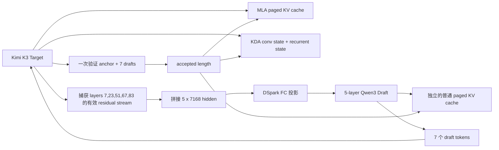

### user
帮我看下dspark这个特性在vllm-ascend的v0.23.0分支上支持了没有


### assistant:commentary
我先确认这里的 “dspark” 在代码里对应的具体模块/开关，然后对照 vLLM Ascend 的 `v0.23.0` 分支检查实现、注册入口和测试；这一步只做只读检查，不会动四机服务。

### assistant:commentary
本地全量关键字暂时没有命中 `dspark`，说明它可能是外部项目名、缩写，或者代码里用了别的组件名。我正在以官方 `vllm-project/vllm-ascend` 的 release 分支为准继续查提交记录和公开资料，避免把 K3 fork 的分支状态当成官方支持。

### assistant:final_answer
结论：**官方 `vllm-project/vllm-ascend` 的 `releases/v0.23.0` 分支目前不支持 DSpark。**

我核对了今天最新的分支头 `f13056df1d22`：

- 分支中没有 `dspark_proposer.py`、DSpark 模型实现或相关测试。
- DSpark 验收测试明确对 vLLM `0.23.0` 做了跳过，理由是：`0.23.0` 尚未集成 DSpark。
- DSpark 的 Ascend 适配目前只合入了 `main`，包括：
  - [Qwen/GLM DSpark #11765](https://github.com/vllm-project/vllm-ascend/pull/11765)
  - [DeepSeek V4 DSpark #11431](https://github.com/vllm-project/vllm-ascend/pull/11431)
  - [DSpark speculative method #12662](https://github.com/vllm-project/vllm-ascend/pull/12662)
- 没有发现目标分支为 `releases/v0.23.0` 的 DSpark backport PR。

另外，如果你问的是 **Kimi K3 + DSpark**，目前也没有看到 Ascend 侧的 K3 DSpark 适配；K3 官方博客里的 370 tok/s DSpark 数据是跑在 **16 张 NVIDIA GB300** 上的，不代表 Ascend 已支持。[Kimi K3 vLLM 博客](https://vllm.ai/blog/2026-07-27-k3)

所以现阶段应按下面理解：

> `vllm-ascend v0.23.0`：不支持 DSpark；`main`：已有部分模型的初步支持，但 Kimi K3 尚未看到适配证据。

### user
评估把main分支的dspark特性移植到vllm-ascend上并适配kimi k3需要多少的工作量和修改量，sglang的相关pr在[sgl-project/sglang#32544](https://github.com/sgl-project/sglang/pull/32544)


### assistant:commentary
我会用 GitHub 代码审查流程拆解这次移植：先读 SGLang PR 的实际改动和依赖，再把 vLLM Ascend `main` 上 DSpark 的提交集与 `releases/v0.23.0`、现有 Kimi K3 实现逐层对比，最后给出按模块、代码量、风险和人天估算。全程只读，不会改代码或启动四机服务。

### user
不需要估人天，看下修改量就行，看下kv cache框架之类的东西


### assistant:commentary
明白，我不再估人天，改成评估“需要动哪些框架、预计文件/代码规模、哪些能复用、哪些必须为 Kimi K3 重写”。我会重点追 DSpark 的 draft KV cache、target/draft cache 对齐、scheduler/metadata、graph capture，以及 K3 的 MLA/KDA 混合状态如何接入。

### assistant:commentary
SGLang 这个 PR 的表面规模（489 文件、13 万行）不能直接作为参考：它自己标注为 preview 且与 main 严重冲突，其中约 11 万行是一次整目录 kernel 搬运。我已经把这部分噪声剥离，正在按真正的 DSpark/K3 提交链统计；目前核心首批改动约 69 文件、`+13.3k/-257`，后续 NPU graph/cache 与 KDA verify 另有约 `+2.5k`，但其中 benchmark/观测代码占比很高。

### assistant:final_answer
结论：如果目标是把 `vllm-ascend main` 已有的 DSpark 固定长度方案移植到 `releases/v0.23.0_ci_new`，并让当前 Kimi K3 W4A8 跑通，属于“中等偏大”的修改，但不需要重写 K3 的整套 KV cache。

预计合理范围：

- 生产代码：约 `1,700～3,000` 行
- 测试代码：约 `600～1,000` 行
- 涉及文件：约 `25～35` 个
- 如果同时要求 draft ACLGraph、动态 confidence/ragged verify、PD、完整 prefix-cache 兼容，则会升到 `4,000～7,000+` 行、约 `40～60` 个文件

最关键的判断是：Kimi K3 的 DSpark draft 模型其实是一个 5 层 Qwen3 全注意力模型，不包含 KDA/MLA。因此 draft 侧可以直接复用普通 paged KV cache；真正复杂的是 target K3 的 hidden-state 捕获和 speculative verify 后的 KDA 状态提交。

## KV cache 结构



### Draft cache

`RadixArk/Kimi-K3-DSpark` 的配置是：

- `num_hidden_layers=5`
- `layer_types` 全是 `full_attention`
- `model_type=qwen3`
- `block_size=7`
- `target_layer_ids=[7,23,51,67,83]`
- 没有 KDA、MLA 或混合注意力

因此 draft cache 不需要参考 SGLang PR 中那套 KDA snapshot 框架，只需要：

- 为 draft 的 5 个 attention layer 注册独立 KV cache layer names。
- 把它们加入 vLLM 的 KV cache groups。
- 为 prefill hidden 注入、draft query block 维护 block table 和 slot mapping。
- rejection 后只保留已接受 token 对应的 draft KV。
- 处理 target cache group 与 draft cache group 的 block size/page size 差异。

这部分 `vllm-ascend main` 的 `AscendDSparkProposer` 已经基本实现，但需要回移到 0.23 的 KV cache API。

### Target MLA cache

K3 target 的 MLA paged KV cache 不需要结构性修改：

- DSpark target verify 对 MLA 来说仍然是一次多 token speculative forward。
- v0.23 当前的 block table、slot mapping 和 speculative token 分配已经被 MTP 使用。
- 主要检查 verify width 从 MTP 的较短长度增到 `8 = anchor + 7 drafts` 后，跨 page boundary 是否正确。

预计这里只需 metadata、边界检查和测试，不需要新建 MLA cache 框架。

### Target KDA 状态

这一块原本是最大风险，但当前 `releases/v0.23.0_ci_new` 已经有相当多基础：

- `kimi_kda_state_shape(..., num_spec)` 已给 conv state 预留 speculative slots。
- `kimi_kda.py` 已区分 speculative token，并使用：
  - `spec_state_indices_tensor`
  - `num_accepted_tokens`
  - speculative causal-conv metadata
  - recurrent-state speculative 路径
- model runner 已有 Mamba/KDA preprocess、postprocess 和 accepted-state copy。

因此不建议照搬 SGLang 的：

- 每 token conv snapshot
- 每 token SSM snapshot
- accepted-step scatter
- 自定义 rollback 框架

先让现有 KDA speculative state 机制承载 DSpark verify。只有真实 gamma=7 测试证明“接受多个 token 后状态不一致”，才需要增加针对 KDA 的 snapshot/commit 算子。

KDA 侧预计修改量是 `0～300` 行生产代码，更多工作会在单测和状态一致性验证上，而不是框架重写。

## 按模块预计修改量

| 模块 | 文件数 | 生产代码量 | 内容 |
|---|---:|---:|---|
| vLLM 0.23 core DSpark backport | 10～15 | 700～1,200 行 | SpeculativeConfig、Qwen3 DSpark model、speculator、draft cache group、scheduler 接口 |
| vLLM Ascend DSpark proposer | 7～10 | 500～900 行 | NPU proposer、KV metadata、slot mapping、Markov head、DP/SP 修复 |
| Kimi K3 target 适配 | 3～5 | 180～350 行 | hidden capture、attention-residual 还原、config 解析、模型注册 |
| KV/cache 补丁 | 3～6 | 150～400 行 | draft cache group、prefix-cache 隔离、block/page 边界 |
| ACLGraph/DP4 兼容 | 3～6 | 150～400 行 | target graph、draft eager、DP padding、FlashComm/SP |
| UT/E2E | 6～10 | 600～1,000 行 | cache、状态提交、acceptance、prefix cache、DP4 |

文件数不能简单相加，因为 model runner、proposer 和 config 文件会重叠。

## 必须改的 K3 专属点

### 1. Draft config 不能直接加载

K3 DSpark checkpoint 使用：

```json
{
  "architectures": ["DSparkDraftModel"],
  "model_type": "qwen3",
  "dflash_config": {
    "mask_token_id": 163824,
    "target_layer_ids": [7, 23, 51, 67, 83]
  }
}
```

而 Ascend main 当前把 `DSparkDraftModel` 注册为 DeepSeek-V4 DSpark 实现，这会选错模型。

需要在 config override 中按 `model_type == "qwen3"`：

- 把 architecture 重写成 `Qwen3DSparkModel`。
- 展平 `dflash_config.mask_token_id`。
- 展平 `dflash_config.target_layer_ids`。
- 保留 `pad_token_id=163839`，不能误当成 mask token。

预计约 `30～80` 行，但这是启动前的硬阻塞项。

### 2. K3 hidden capture

不能直接捕获 decoder layer 返回的裸 `hidden_states`。K3 有 learned attention residual：

```text
hidden_states + block_residual
    → residual projection
    → residual norm
    → 下一层输入
```

必须捕获“当前层输出、下一层输入之前”的有效 stream，否则即使 shape 正确，draft FC 接收到的 hidden 分布也不对，acceptance 会接近 0。

需要：

- 为 K3 model 增加 capture layer 集合。
- 在 7、23、51、67、83 层输出处恢复有效 residual stream。
- 返回 aux hidden states。
- 在 runner 中拼成 `[N, 5 × 7168]`。

这一块预计 `100～200` 行。

### 3. DP4 与 FlashComm/SP

当前目标拓扑是 TP16×DP4×EP64，因此必须带上 Ascend main 已有的：

- [multi-DP DSpark 修复 #12612](https://github.com/vllm-project/vllm-ascend/pull/12612)
- [DSpark SP 修复 #12777](https://github.com/vllm-project/vllm-ascend/pull/12777)

不能只移植单卡测试所需代码。

## Prefix cache 是一个独立风险点

K3 当前已验证过 prefix cache，但加入 draft KV group 后，cache manager 会同时看到：

- Target MLA group
- Target KDA/Mamba group
- Draft full-attention group

vLLM 目前还有一个未合入问题修复：draft KV group 可能干扰 core prefix-cache lookup。[vLLM PR #48459](https://github.com/vllm-project/vllm/pull/48459)

因此建议修改量里预留 `100～250` 行，用于：

- draft group 不参与 target prefix-cache hit 判定；
- prefix hit 后用 target aux hidden 补齐 draft KV；
- 防止 draft cache miss 让整个 target prefix lookup 失效；
- 覆盖重复长前缀和跨 block boundary。

第一版如果关闭 prefix cache，可以暂时避开，但无法直接达到当前 K3 服务配置的特性组合。

## ACLGraph 边界

Ascend main 的 MRV1 DSpark proposer明确把 draft 设为 eager：

```python
self.use_cuda_graph = False
```

因此最合理的第一阶段是：

- K3 target verify：继续使用 `FULL_DECODE_ONLY`
- DSpark draft：eager
- fixed verify width：8
- greedy Markov sampling
- 不做 confidence/ragged verify

如果要求 draft 也进入 ACLGraph，需要再移植 MRV2 DSpark speculator和 graph buffer，修改量大约额外增加：

- `8～15` 个文件
- `800～1,500` 行生产代码

## SGLang PR 应该怎样参考

[sgl-project/sglang#32544](https://github.com/sgl-project/sglang/pull/32544) 显示的 `489 files / +130k` 不能直接作为工作量参考：

- PR 是 draft。
- PR 自述与当前 main 严重冲突。
- 约 11 万行来自一次 kernel 目录整体搬运。
- 有效的初始 DSpark 提交是 69 文件、`+13,354/-257`，其中大量是通用 scheduler、SPS profiler、confidence planner、observability，不是 K3 NPU 专属代码。
- 它实现了比当前 vLLM Ascend main 更完整的 confidence/ragged verify。

SGLang 对我们最有价值的是状态语义参考：

- capture 哪几层 hidden；
- target hidden 如何初始化 draft KV；
- verify 后 target/draft/KDA 各自提交什么；
- KDA rejected state 必须回滚到哪个 accepted step。

而不是照搬它的 cache 或 scheduler 实现。[SGLang K3 NPU 跟踪 issue #32519](https://github.com/sgl-project/sglang/issues/32519)

## 推荐的最小移植边界

第一版应只做：

1. 回移 vLLM 核心的 Qwen3 DSpark 固定长度能力。
2. 回移 Ascend MRV1 DSpark proposer。
3. 适配 K3 draft config 与模型注册。
4. 实现 K3 五层 hidden capture。
5. 复用现有 MLA/KDA speculative cache。
6. Target 保持 `FULL_DECODE_ONLY`，draft 使用 eager。
7. 覆盖 TP16×DP4、gamma=7、prefix cache off/on。
8. 不移植 confidence scheduler、SPS/STS、compact ragged verify、MRV2 draft graph。

这个边界下，我认为最可信的修改量是：

> 约 25～35 个文件，生产代码 `1,700～3,000` 行，测试 `600～1,000` 行；核心 cache 框架以复用为主，而不是重写。

上游 vLLM 的基础实现来自 [vLLM DSpark PR #46995](https://github.com/vllm-project/vllm/pull/46995)，Ascend 侧主要参考 [Qwen/GLM DSpark #11765](https://github.com/vllm-project/vllm-ascend/pull/11765) 和后续 DP/SP 修复。该 vLLM PR明确把动态 confidence scheduling 排除在首版范围之外，因此不要把“固定长度 DSpark 跑通”和“完整论文版 DSpark”混成一个移植目标。


### user
无所谓ut，也就是说如果我不管动态的mtp的数值，我拉起的时候像mtp一样写死mtp=3或者mtp=1就可以对吧


### assistant:commentary
对，方向上可以把它做成固定长度，不需要移植动态 confidence/ragged verify；不过参数仍应写成 `method=dspark`，不能写成 MTP，而且 K3 这份 drafter 的训练 block size 是 7，我再确认一下当前实现是否允许安全地截短到 3/1。

### assistant:final_answer
对，**可以不做动态长度**，固定 speculative token 数即可；但 Kimi K3 这份 DSpark checkpoint 不能随意写成 1 或 3。

它的训练配置是：

```json
"block_size": 7
```

DSpark 是整块半自回归 drafter。运行长度小于训练 block size 会破坏 Markov-head/block 布局，上游代码也明确认为可能产生错误或乱码，而不仅仅是加速效果变差。[vLLM 配置检查](https://github.com/vllm-project/vllm/blob/main/vllm/config/speculative.py)

所以第一版应该固定写成：

```bash
--speculative-config '{
  "method": "dspark",
  "model": "RadixArk/Kimi-K3-DSpark",
  "num_speculative_tokens": 7,
  "draft_sample_method": "greedy"
}'
```

对应关系是：

```text
7 个 draft token
+ 1 个 anchor/bonus token
= [REDACTED_SECRET] 每轮验证 8 个 token
```

注意两点：

- 参数是 `method=dspark`，不是 `method=mtp`。
- 建议严格固定为 `7`，不要先尝试 `1` 或 `3`。

如果一定要固定成 1 或 3，需要：

- 使用针对 block size 1/3 训练的 DSpark drafter；或者
- 重新训练/蒸馏 FC、draft backbone 和 Markov head。

所以可以完全不移植动态 confidence/ragged verify，但固定值应该是 **DSpark=7**。这样修改范围还能进一步收缩：不需要 dynamic scheduler、SPS/STS、confidence relay，只保留固定宽度 proposer、KV cache 和 KDA accepted-state 提交。

