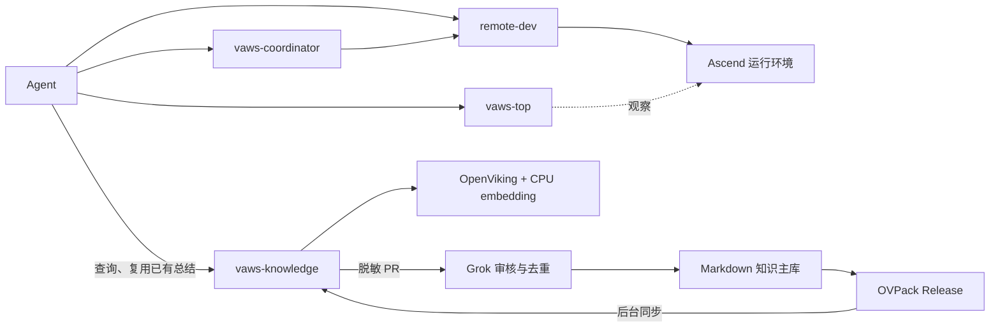

宽松原则也应覆盖验证：根据具体改动选择足够的测试，已有证据能用就用。资源归属、公开脱敏、实际执行结果仍由组件检查，Agent 不需要额外走确认流程。

我建议先精简这些流程和输出，再接 OpenViking，随后通过真实开发任务补最有价值的自动化。判断标准就是：**有没有减少额外调用、文档阅读、等待和重复实验。**

完整结论已整理到[开发效率 review](<redacted:local-path:8727341f1a45>)，也更新了架构草案。本轮只做审查和设计，正式代码尚未修改。

### user
合理，这些让你觉得不方便或者不爽的点都可以优化掉，然后整体看下在OpenViking接入之后下一步的工作，可以总结一个架构图以及spec出来做为下一步工作的一个方向

### assistant:commentary
我会把这轮结论整理成一份实施方向 spec，包含整体架构、组件职责、要精简的流程、OpenViking 接入顺序和验收标准。先核对现有文档契约，再把它放进仓库，作为下一步实现的依据。

### assistant:commentary
Spec 里会把 Agent 的日常操作和组件内部步骤分开：Agent 只需开发、运行实验、给出结论，记录、脱敏、审核和同步由组件完成。OpenViking 首版直接复用已有总结，不默认再调用一次模型提炼；Windows 原生验证会放在早期，避免接完后才发现平台问题。

### assistant:commentary
架构图和 spec 已放进仓库，并同步了目标架构与结果输出契约。实施顺序定为：精简开发入口 → 本地知识接入 → 早期平台验证 → 自动 PR 与预建分发 → 真实开发验收。文档路径、脱敏和格式检查已通过；实现批次都明确标为 planned。

### assistant:final_answer
已整理成正式的 [架构与实施 Spec](<redacted:local-path:58cfa596ee7c>)，并同步了目标架构、结果输出契约和文档索引。

核心原则是：**Agent 正常开发，VAWS 自动处理环境、记录和知识流转。**

Spec 明确了下一步顺序：

1. **精简开发入口**：减少重复确认、必填计划和记账，支持事后引用证据、紧凑输出及自定义实验。
2. **接入本地知识**：标题＋正文即可捕获，直接复用已有总结，默认不再调用模型提炼一次。
3. **尽早验证平台**：Windows 原生 PowerShell、Intel Mac、Apple Silicon 分别验证。
4. **打通知识流转**：自动脱敏、PR、Grok 审核、预建向量发布和客户端同步。
5. **用真实开发验收**：检查额外操作是否减少、有效 NPU 结果是否更快获得、重复排查是否减少。

文档路径、脱敏和格式检查已通过。本轮完成的是实施契约，功能批次均明确标为 **planned**，避免把设计当作已经接入。

### user
Intel mac可以不用考虑，只需要考虑arm的mac和x86的windows就行，我理解可以先做起来了，先让grok干起来

### assistant:commentary
我会把平台范围收敛到 ARM Mac 和 x86 Windows，更新 spec，然后把第一批实现交给 Grok，并同步这次确定的减负原则。

### assistant:commentary
平台范围已改好：只支持 ARM64 macOS 和 x86-64 Windows。第一批让 Grok 实现开发流程减负和 OpenViking 本地最小链路；我保留技术判断和验收。会用独立工作树承接，避免动到当前目录里的设计文档。

### assistant:final_answer
Grok 已启动任务 **OpenViking A+B Agent Flow Integration**，确认已开始读取交接材料和 spec。

- 平台仅考虑 **ARM64 Mac + x86-64 Windows，CPU-only**。
- 第一批实现：**开发流程减负 + OpenViking 本地最小链路**。
- Workspace 和知识包分别使用独立工作树。
- Grok 负责实现，我负责技术判断与验收。

[Spec 已同步更新](<redacted:local-path:58cfa596ee7c>)。

### user
ok的，然后你可以让kimi code去坐下remote-dev的工具补全和特性增强，然后基准就是提供一个统一的工具，然后使用习惯完全兼容cursor、codex、claude code、Kimi code以及grok

### assistant:commentary
我会把 remote-dev 的工具补全和兼容性增强交给 Kimi Code。先确认现有工具接口和五个客户端的差异，再给它一份明确的交接：共用一套实现，各客户端保持原生使用习惯。

### assistant:commentary
现有 remote-dev 已有 Read、Edit、Patch、Bash、搜索和进程管理工具。我会让 Kimi 先列出五个客户端的接口差异，再补齐缺口；验收沿用 remote-dev 兼容性检查流程，分别记录工具发现和真实调用结果。它会使用独立工作树，与 Grok 的 OpenViking 任务并行推进。

### assistant:commentary
交接已准备好，重点包括搜索参数补全、执行会话的输出续读与 stdin 支持，以及五客户端的配置兼容。当前适配层主要还是说明文字，Kimi 新版配置路径也与包文档不一致，需要先查证。现在启动 Kimi；它完成后由我独立验收。

### assistant:final_answer
Kimi Code 已启动，已读取交接并开始检查代码。

任务基准已明确：统一 remote-dev 内核，补齐文件、搜索和执行会话能力，兼容 Cursor、Codex、Claude Code、Kimi Code、Grok 的原生使用习惯，并逐客户端做真实调用验证。

它在独立工作树推进；Grok 的 OpenViking 任务继续运行，我负责独立验收。

### user
整体看一下后续的工作以及哪些可以并行的，可以启用多个grok和kimi去并行去完成，然后设计方面有哪些不确定的点我们可以在讨论一下

### assistant:commentary
我先核对 Grok 和 Kimi 的实际进展，再把后续工作按依赖和代码归属拆开。边界明确的部分会直接并行启动，涉及产品方向的分歧整理出来和你讨论。

### assistant:commentary
目前两边都已开始改代码：Grok 在做流程减负和本地知识接入，Kimi 在补搜索参数、文件操作别名和可写 stdin 的执行会话，尚未完成验收。

可以再并行拆出两条独立实现：知识贡献与审核、OVPack 发布与同步。我会各交给一个新的 Grok/Kimi，共四个实现任务。跨平台和五客户端的完整验收，需要等核心接口稳定后再接上；公共发布、依赖升级和 NPU 闭环也要放在集成之后。

### user
<send_user_message_question_reply>
[{"questionItemId":"[\"request_user_input_async\",\"call_ASjC1e0j2mBiJtzVPK5NHG38\",0]","question":"查询时，本地尚未审核的经验与公共知识都相关，你希望怎样呈现？我倾向按问题相关性和环境匹配度排序，同时清楚标出“本地观察／已审核”，避免有用的新经验被隐藏。","answer":"一起返回，我理解审核与否其实并不关键，审核只是做为负责任的态度去审核公共的部分，本地的我理解都可以做为可以信任的来源，而且所有的知识都只是参考并不是公理我认为"}]
</send_user_message_question_reply>

### assistant:commentary
明白。检索会把本地经验和公共知识一起返回，按相关性、适用条件排序；审核状态只说明公共内容经过了什么处理，不作为本地经验的准入门槛或降权依据。所有知识都作为参考，最终判断仍由 Agent 结合当前代码和运行结果完成。我会同步给正在实现检索和审核链路的 Grok。

