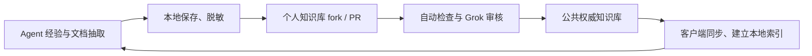

### user
调研一下业界稳定好用的知识库组件，最好是比较契合我们这个模式的，可以抄作业的

### assistant:commentary
我先核对我们现有知识库的分层和使用方式，再查几个成熟方案，重点看哪些设计能直接借鉴到 VAWS。

### assistant:commentary
我们这个模式最关键的是：知识要能带上运行环境、版本和验证证据，还要区分候选经验与已确认结论。通用 RAG 和 Agent memory 只能覆盖其中一部分。我会分别看“检索组件”和“知识管理机制”，筛出值得直接用或借鉴的部分。

### assistant:commentary
目前最值得抄的是三类：Basic Memory 的文件存储与 MCP 入口，Haystack 的检索流水线，以及 OSV/GitHub Advisory Database 的版本范围、来源和审核机制。最后一类虽然用于漏洞库，但与我们“收集故障经验、确认适用范围、审核后共享”的流程很接近。另一个发现是这些项目变化很快，我正在按发布版本核对，避免把旧介绍当成当前能力。

### assistant:commentary
我还确认了一个直接影响使用的缺口：当前查询函数只提取英文、数字等 token；一个“中文查询与中文摘要完全相同”的最小用例，得分仍是 0。因此建议优先补中文检索和命中解释。现阶段已盘点的共享包与项目条目共 86 条，还没有数据规模方面的证据要求我们引入大型知识库服务。我会把推荐顺序、可读源码位置和验证方案整理成文档。

### assistant:commentary
推荐可以收敛了：近期先改进现有知识组件的检索；Basic Memory 和 OSV 分别作为交互方式、知识管理机制的参考。Graphiti、OpenViking 留作后续扩展。一个影响选型的细节是，Basic Memory 当前正式版仍依赖 FastMCP beta，我已在文档里注明，避免把“模式契合”直接等同于“可稳定替换”。

### assistant:final_answer
调研后，**最值得我们抄的是：OSV 的知识管理机制、Basic Memory 的 Agent 使用方式，以及 Haystack 的检索组件。** 完整比较和源码入口已整理到[调研文档](<redacted:local-path:72bd04313518>)。

我们这套是**带运行环境、版本范围和验证证据的工程经验库**。选型既要看能否搜到，也要看能否判断“这条结论适不适用于当前任务”。

| 方案 | 值得抄什么 | 我的判断 |
|---|---|---|
| **[OSV / GitHub Advisory Database](https://github.com/github/advisory-database)** | 结构化条目、版本范围、来源、审核、撤回、社区 PR 贡献 | **知识管理机制最契合。** 它用于漏洞库，但与我们收集故障经验、审核后共享的流程很接近 |
| **[Basic Memory](https://docs.basicmemory.com/reference/technical-information)** | 文件作为规范来源、数据库作为索引、MCP 读写、关联知识 | **现成产品中最贴近我们的工作方式。** 值得试用，也适合作为实现参考 |
| **[Haystack](https://github.com/deepset-ai/haystack)** | 检索、过滤、多路结果融合、重排的组件化流水线 | **最值得评估的检索框架。** 可接在现有 `vaws-knowledge` API 后面 |
| **[SQLite FTS5](https://sqlite.org/fts5.html)** | 本地全文索引、BM25 排名 | **当前规模下最轻的起点。** 中文处理需要明确配置和验证 |
| **[pgvector](https://github.com/pgvector/pgvector) / [Qdrant](https://qdrant.tech/documentation/search/hybrid-queries/)** | 向量检索、结构化过滤 | 已有 PostgreSQL 优先考虑 pgvector；需要独立向量服务再考虑 Qdrant |
| **[Graphiti](https://github.com/getzep/graphiti)** | 事实有效时间、历史变化、证据来源关联 | 先借鉴数据模型；大量历史、多跳查询出现后再考虑图数据库 |
| **[OpenViking](https://github.com/volcengine/OpenViking)** | 上下文分层加载、目录导航、检索轨迹 | 很契合 Agent 场景，适合参考；核心接管仍需补长期运行验证 |

其中我最推荐认真看 **OSV**。它已经把“什么时候受影响、哪个版本修复、信息来自哪里、是否经过审核、错误记录如何撤回”做成明确的数据机制。我们可以借鉴这些语义，再保留 NPU、CANN、拓扑、执行模式等领域坐标。[OSV 规范](https://ossf.github.io/osv-schema/)

**近期落地，我建议保持现有知识 API，优先补检索能力。** 我核对了当前安装包和项目语料，共 86 条，不含其他工作区和候选目录；同时复现了一个具体问题：当前 tokenizer 不提取中文，中文查询与中文摘要完全一致的最小用例，打分仍为 **0**。因此优先级应是：

1. 补中文、英文错误串及二者之间的检索。
2. 返回命中原因、适用范围、验证状态和证据引用。
3. 保留文件作为规范来源，让索引可以重建。
4. 用真实故障查询比较轻量索引与 Haystack，再决定是否增加向量服务。

还有一个影响“稳定好用”的细节：Basic Memory 当前正式版 **v0.23.2** 固定依赖 **FastMCP 4.0.0b1**，所以我把它列为优先参考和试用对象；Haystack 当前已到 **3.1.1**，接入时要按新版验证。[Basic Memory 依赖](https://github.com/basicmachines-co/basic-memory/blob/v0.23.2/pyproject.toml)、[Haystack 发布](https://github.com/deepset-ai/haystack/releases/tag/v3.1.1)

文档里附了固定版本的源码入口和 40 条建议验收用例。本次完成了官方资料、发布与部分源码核对，尚未对候选产品做部署和稳定性实测。

### user
我理解并不需要轻量，可以满足文档的信息抽取+检索+方便agent贡献沉淀经验的中英文的知识库就行

### assistant:commentary
明白，轻量不是硬约束。你要的是一套完整的中英文知识库：能从文档抽取信息、支持检索，也方便 Agent 持续贡献经验。我按这个标准重新比较 RAGFlow、Dify、OpenViking 和其他合适的成品，重点核对文档处理、Agent 写入接口和知识更新流程。

### assistant:commentary
按这个标准，RAGFlow 和 WeKnora 应该进入首选。两者都覆盖文档处理和检索，差别在 Agent 写入：RAGFlow 这个版本的官方 MCP 主要提供查询，贡献经验可走已有 HTTP API；WeKnora 已有直接从文本创建知识的 MCP 工具。OpenViking 的 `remember`、`write`、`edit` 则更贴近 Agent 自动沉淀经验的流程。

### assistant:final_answer
对，我上一轮过于强调轻量和兼容现有结构了。**按你明确的需求，应该优先选完整知识平台。我现在推荐先试 RAGFlow，重点对比 WeKnora；OpenViking 作为自动沉淀经验的候选。**

重新核对后的区别是：

| 平台 | 文档抽取与检索 | Agent 贡献经验 | 推荐理由 |
|---|---|---|---|
| **RAGFlow** | 文档解析、OCR、摘要、关键词、自定义信息抽取、混合检索、引用较完整 | 已有 HTTP API；官方 MCP 主要负责查询，写入补一层封装即可 | **默认首选**，适合建立完整共享资料库 |
| **WeKnora** | 多格式文档处理、混合检索、Wiki 整理与版本历史 | 官方 MCP 直接提供从文本、文件、URL 创建知识 | **很契合我们的使用方式**，Agent 贡献入口更现成 |
| **OpenViking** | 文档与代码资源摄取、语义检索、分层上下文 | 原生 `remember`、`write`、`edit`，可从会话提炼记忆 | **自动积累经验最自然**，需要重点测试技术文档质量 |
| **Dify** | 知识流水线、检索、文档与片段管理 | Knowledge API 支持创建、更新和检索 | 如果还要搭可视化问答应用和工作流，可以优先考虑 |

这些能力已核对官方资料：[RAGFlow 信息抽取](https://github.com/infiniflow/ragflow/blob/v0.27.1/docs/guides/agent/ingestion_pipeline/configure_transformer_component.md)、[WeKnora MCP](https://github.com/Tencent/WeKnora/blob/v0.8.0/mcp-server/README.md)、[OpenViking MCP](https://github.[REDACTED_SECRET].4.19/docs/en/guides/06-mcp-integration.md)、[Dify API](https://docs.dify.ai/en/api-reference/guides/knowledge)。

对我们来说，目标流程可以很直接：

**文档导入 → 平台抽取并建立索引 → Agent 检索使用 → Agent 提交经验笔记 → 其他任务继续检索复用。**

经验按普通 Markdown 写“问题、原因、解决方法、适用环境、来源”即可。平台负责存储和检索，现有 `vaws-knowledge` 可以收缩为接入与迁移层，具体保留什么由验证结果决定。

**中英文要验收的是跨语言检索效果**：中文问题能找到英文手册，英文报错能找到中文经验。这需要配好多语言 embedding 和重排，不能仅凭平台支持中文界面判断。

我已按这个口径更新[选型文档](<redacted:local-path:1f55338e567e>)。接下来最有价值的对比就是：用同一批资料，在 RAGFlow 和 WeKnora 上完成“导入—检索—Agent 写经验—另一个任务搜到—更新生效”的闭环。当前推荐基于资料与源码核对，尚未做部署实测。

### user
我前面想了一下，我具体的需求可能是这样的，现在这个知识库其实我感觉可以随时废弃不用管

我预期的知识库或者整个项目的初始化和知识流转需要完成以下整个流程

我会让vaws的init自己去创建一个fork（如果没有的情况下），如果有的话会进行agents.md的注入，以及会拉取对应的包，包里面包括了我们现在定义的几个mcp服务分别是remote-tool、coordinator、top、知识库，重要的是，这个东西会做一个工作，会在agents.md做一个注入，让无论所有agent工具都会在完成一个session的任务之后总结这个session中有用的知识以及获得到的经验并提交pr到知识库本身。然后知识库分成两级，一级是服务端，这个是提供本地的mcp服务以及一个核心的能力。另一极是知识库本身，包括了知识库的内容。然后知识库的本身会由gork bot做一个全自动的review确保合入合法，然后这个地方也需要考虑到去重。然后知识库的客户端会周期性的拉取最新的权威知识到本地（因为我们肯定不会提供在线服务，我们也没有服务器），这样就可以做到一个所有人的知识的循环。大概的想法是这样的，你看看有没有需要我补充的或者啥的

### assistant:commentary
这个方案已经很清楚了：以 Git 仓库流转知识，每个人运行本地 MCP，公共仓库自动审核合入，客户端同步到本地。我会按这个目标检查初始化、经验提交、审核去重和同步几个环节，现有知识库不作为约束。

### user
<send_user_message_question_reply>
[{"questionItemId":"[\"request_user_input_async\",\"call_raoagbad36yOYg6OAPfmdPW3\",0]","question":"你说的 init 自动创建 fork，指的是哪个仓库？","answer":"自动创建vaws的fork以及知识库的fork"},{"questionItemId":"[\"request_user_input_async\",\"call_raoagbad36yOYg6OAPfmdPW3\",1]","question":"进入共享知识库的内容，是否全部公开，任何人都可以下载？","answer":"全部公开；提交前自动脱敏"},{"questionItemId":"[\"request_user_input_async\",\"call_raoagbad36yOYg6OAPfmdPW3\",2]","question":"Grok bot 对格式、脱敏、重复和内容一致性检查通过后，是否直接自动合入？","answer":"按知识类型设不同的自动合入标准"}]
</send_user_message_question_reply>

### assistant:commentary
这三个边界可以定下了：初始化同时准备 VAWS 和知识库的 fork；共享内容全部公开、上传前脱敏；不同知识类型采用不同的自动合入标准。还需要补齐的主要是 session 收尾触发、去重与纠错规则，以及客户端同步方式。

### assistant:commentary
`AGENTS.md` 能约定 Agent 总结经验，但无法单靠文字保证每种客户端都执行 session 收尾；还需要客户端适配，以及本地待提交队列来处理重试。去重也要区分“重复描述”“补充证据”和“不同版本下的相反结论”。我会把这些边界和按类型自动合入的建议整理进设计稿。

### assistant:final_answer
**这个方案成立，现有信息已经足够确定总体架构。** 初始化创建或复用两个 fork、上传前脱敏、按知识类型自动合入，这三个边界已经明确。

你说的“两级”建议定义成两个独立发布的组件：

- **知识引擎包**：提供本地 MCP，负责文档抽取、检索、贡献提交和同步。
- **知识内容仓库**：保存正文、来源、适用条件和证据，通过 PR 持续更新。新增知识无需升级引擎包。

我建议再把下面六件事写进需求。

**1. AGENTS.md 注入之外，需要可靠的收尾机制。**

文字约定无法保证所有 Agent 客户端都执行 session 收尾。应明确支持的客户端，分别接入指令文件、MCP 和可用的生命周期 hook。

Agent 负责提炼，本地引擎负责保存、提交和重试。重要发现先保存候选，任务完成时提交增量；恢复同一 session、重复触发收尾都不能重复开 PR。没有新知识就不提交，断网则进入本地待提交队列。

**2. 自动合入标准按类型区分，而且要保留证据状态。**

可以先采用这四类：

| 类型 | 建议的自动收录标准 |
|---|---|
| 文档知识 | 有来源和版本定位，摘要忠于原文 |
| 排障经验 | 有症状、适用条件、处理过程和实际观察结果 |
| 兼容性／性能结论 | 有必要环境、执行配置和可追溯证据；性能比较还需基线及测量条件 |
| 待验证线索 | 有推理依据和验证方向，明确标记未验证 |

**审核通过表示符合收录标准，不能自动等同于结论已被独立验证。** 检索结果应同时返回“文档支持、作者报告实测、独立复现、待验证”等状态。

**3. 去重需要识别知识关系。**

同义描述可以合并；新证据应补到已有条目；不同版本下的相反结果应保留适用条件；同一条件下的冲突则保留双方证据并复核。

还要处理并发：两个相似 PR 同时通过审核，合入前仍需对最新上游重新查重。知识也必须支持修订、替代和撤回。

**4. 脱敏和审核要各自放在正确的位置。**

脱敏必须覆盖正文、附件、PR 描述和提交信息，并发生在首次上传之前。仓库侧再次检查只是补充。

自动审核可以运行在 GitHub 托管 Actions 中，通过 Grok API 完成，无需自建服务器。审核程序应来自可信上游，贡献内容只作为数据读取；知识 PR 不能修改自己的审核规则。GitHub 对 fork PR 的 secrets 和执行权限有明确区分，实现时需要按这个边界设计。[GitHub 官方说明](https://docs.github.com/en/actions/reference/security/securely-using-pull_request_target)

**5. 同步应维护独立的权威快照。**

个人 fork 用于贡献，本地另存公共上游的只读快照。同步时先获取、校验、更新索引，全部成功后再切换；失败继续使用上一份有效数据。

默认可以在 MCP 启动时及运行期间周期检查。若要求所有 Agent 都关闭后仍然更新，就需要额外的系统后台调度。

**6. 文档抽取和中英文检索仍然要作为完整能力保留。**

文档入口应保留章节、页码、表格、代码和来源版本，再生成可共享的知识。公共库分发整理后的正文，避免每个客户端重复解析同一份 PDF。

验收要实际覆盖“中文问题找到英文手册”“英文报错找到中文经验”，以及版本号、算子名等精确检索。检索索引可以重建，Git 中的知识正文是持久来源。

这些约束也会调整前面的组件选型：优先考察**文件作为知识来源、索引可重建、本地运行和 Agent 写入**的能力，再比较抽取与检索质量。

