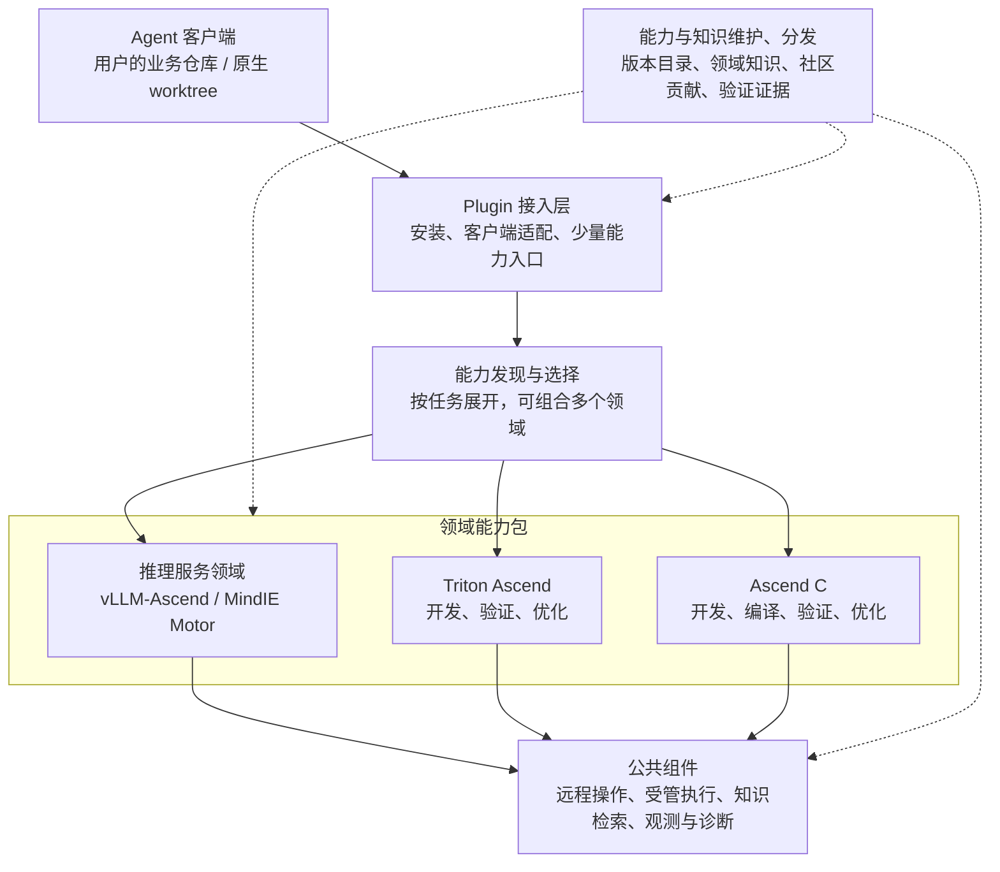
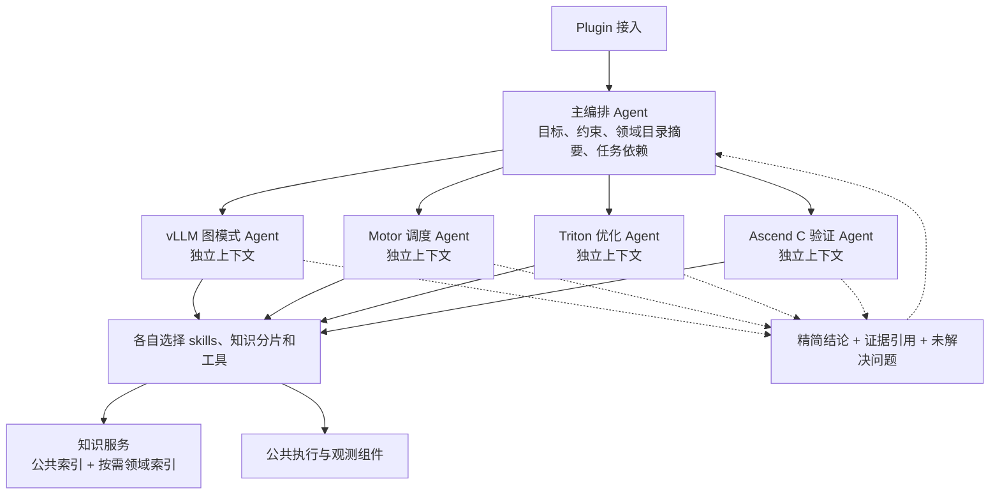

### user
看看issue关于新架构的讨论，然后看看整体怎么去调整吧，我理解我们先需要把改进之后的架构给定义出来，首先我理解接口是比较确定了，可能就是通过plugin机制整体接进来，然后是二级的分发的区，可能会路由到mindie motor/vllm-ascend、Triton ascend、ascendc几个不同的二级区域，然后可能就是二级的区域会有自己的skill包和知识库，然后接下来就是一些公共组件的mcp，我现在大概想的是这样的，你可以整体看看

### assistant:commentary
我先看相关 issue 和现有架构文档，重点核对 plugin 入口、二级领域分发、各领域的 skill／知识库，以及公共 MCP 组件的边界，再整理一版可供讨论的目标架构和调整顺序。

### assistant:commentary
找到了主要的路线讨论：[#195](https://github.com/vllm-ascend-workspace/vllm-ascend-workspace/issues/195)。它与你的方向基本一致，也明确提出先定义职责再重构。我会进一步核对“领域能力包”的边界，尤其是多个领域如何组合，以及领域知识怎样共用检索和分发服务。

### assistant:commentary
当前主干已经有 remote-dev、coordinator、knowledge、top 的职责划分，可作为公共基础。主要调整点在上层：把依赖 VAWS 仓库路径的安装和客户端接入独立出来，再把现有业务能力整理成领域包。客户端接入部分我也会用 OpenAI Docs 核对 Codex 的插件边界。

### assistant:final_answer
我看了 [issue #195](https://github.com/vllm-ascend-workspace/vllm-ascend-workspace/issues/195)，也对照了当前主干的接入代码、组件职责和知识维护方案。**你的方向可以作为目标架构：Plugin 统一接入，按任务发现领域能力，各领域维护自己的 skills 和知识，底层复用公共组件。**

目前 issue 还没有评论，下面是我建议进一步明确的设计。

## 1. 整体架构

这里需要补充两个横向部分：

- **本机公共安装与运行环境**：承载插件资源、依赖、配置和缓存，与业务代码目录分开。
- **能力与知识的维护、分发**：负责内容如何产生、更新和交付；日常开发按需消费这些成果。

## 2. 二级区域应当是“可组合的领域能力包”

你提出的几块都合理。不过，**MindIE Motor 和 vLLM-Ascend 最好分别成包，归入同一个推理服务领域**。

Motor 自身可以对接 vLLM、SGLang，负责 PD 部署、调度和负载均衡。因此，一个任务可能同时需要 Motor 和 vLLM-Ascend 的能力。[MindIE Motor 官方说明](https://github.com/Ascend/MindIE-Motor/blob/master/README.md)

建议先定义这四个包：

| 能力包 | 主要职责 | 当前基础与迁移判断 |
|---|---|---|
| **vLLM-Ascend** | 模型适配、服务与 PD、正确性、性能、图模式和分布式调试 | 已有主要业务能力，优先迁移 |
| **MindIE Motor** | 部署配置、请求调度、PD 编排、故障恢复，与引擎联调 | 纳入目标架构，支持范围需用真实任务建立 |
| **Triton Ascend** | 算子开发、正确性验证、性能优化 | 已有四个相关 skill，可作为第二个领域验证模块化效果 |
| **Ascend C** | 算子实现、编译与加载、数值验证、性能优化 | 复用已有构建和验证经验，补齐独立入口与领域内容 |

每个包至少定义：

- 解决什么任务，以及入口如何被发现。
- 自己的 skill 内容和必要的脚本、适配器。
- 知识来源与默认检索范围。
- 所需工具、环境配方和依赖。
- 维护者、支持范围与已有验证证据。

**包是维护和分发单位，任务可以同时使用多个包。** 例如，从 vLLM 的性能问题追到 Triton kernel，应该能够自然展开 Triton 能力，并沿用同一次任务的源码、环境和证据关联。

## 3. Plugin 与二级分发，重点是控制加载量

Plugin 作为用户接入形态已经比较明确。Codex 官方也将 skills 和 MCP servers 作为插件的组成部分；但安装后何时生效有客户端生命周期要求，所以首版应依靠已安装资源的按需读取，动态安装和热切换另外验证。[官方插件文档](https://learn.chatgpt.com/docs/plugins)

我建议初版这样实现：

1. **入口只暴露少量能力摘要**，让 Agent 知道有哪些领域。
2. 确认相关领域后，读取该领域的索引。
3. 确定具体任务后，再读取对应 skill、参考资料，按需查知识。
4. 真正需要执行时，才使用相关工具、准备缺少的环境或设备。

初版用一个轻量入口 skill、领域索引和包内资源就能建立这条路径。是否需要专门的发现工具，等目录规模和实际检索成本证明有必要再决定。

**要检查客户端最终注入了什么。** 如果增加一个总入口后，所有叶子 skill 的描述仍然全量进入每个任务，上下文成本依然存在。公共 MCP 的工具目录也要一起核对。

普通代码阅读和 PR review 可以直接使用原生工具；用户指定的现有容器继续按给定端点和命令操作。

## 4. 各领域拥有知识内容，公共组件提供知识服务

“各领域有自己的知识库”可以进一步定义为：

> **领域分别维护知识的内容、范围和质量，公共知识组件统一提供导入、索引、查询与分发能力。**

建议区分：

| 知识范围 | 典型内容 |
|---|---|
| 公共基础知识 | NPU、CANN、HCCL、通用 profiler 和环境经验 |
| 领域知识 | Motor 调度、vLLM 图模式、Triton 编译、Ascend C 优化 |
| 项目知识 | 特定模型、私有分支、项目约定、实际部署条件 |

查询默认结合当前项目和相关领域，必要时扩展到公共知识。各领域可以共用服务和模型资源，同时保留清楚的来源与检索范围。

当前主干已经将通用领域知识放到独立 corpus，项目 Markdown 作为可选挂载；知识生产、维护也与普通开发任务分开。这部分可以继续演进为多领域机制。[当前知识维护设计](https://github.com/vllm-ascend-workspace/vllm-ascend-workspace/blob/main/docs/knowledge-maintenance.md)

维护链路可以定义为：

**公开上游／已有贡献选择下的任务经验 → 领域整理与修订 → 审核发布 → 本地按需同步与检索 → 后续证据纠错。**

领域维护者负责内容；知识组件负责机制。知识仍保留适用版本、证据和不确定性。

## 5. 公共组件沿用现有边界，补齐领域适配

当前组件划分已经能支撑这套结构：

| 公共组件 | 继续负责 |
|---|---|
| **remote-dev** | 明确端点上的文件、命令、进程、日志与产物操作 |
| **vaws-coordinator** | 受管环境、源码输入、设备和端口、执行与恢复 |
| **vaws-knowledge** | 知识导入、索引、检索、维护和分发机制 |
| **vaws-top** | 设备与资源观测 |
| **diagnostics** | 日志关联、失败诊断材料和已有配置下的报告机制 |

这些职责已有主干合同可复用；MCP、CLI、Python API 按调用需要提供入口。[当前组件职责](https://github.com/vllm-ascend-workspace/vllm-ascend-workspace/blob/main/docs/target-state.md)

有两处边界需要特别明确：

- **通用执行与领域语义分开。** coordinator 负责运行和资源生命周期；服务是否 ready、模型输出是否正确、性能是否改善，由领域能力解释。对 Motor 管理的现有集群，沿用它的资源与调度机制。
- **按实际依赖拆公共能力。** 例如现在的 `ascend-profiling-collection` 会启动 vLLM 服务并调用 `/start_profile`，这部分仍属于 vLLM 适配；可复用的数据读取、分析基础可以单独共享。[现有采集入口](https://github.com/vllm-ascend-workspace/vllm-ascend-workspace/blob/main/.agents/skills/ascend-profiling-collection/SKILL.md)

## 6. 整体调整顺序

**第一步：先形成架构定义。**

建议先交付一份目标架构和能力矩阵，明确：

- 上面四个领域包的职责和代表任务。
- Plugin → 领域包 → 公共组件的调用关系。
- 安装目录、业务源码、项目配置、任务状态的边界。
- skill 的发现／加载方式，以及知识的维护／检索范围。
- 从现有代码迁往新职责的映射。

**第二步：完成安装与工作目录解耦，迁移 vLLM-Ascend。**

这是目前最具体的结构调整点：主干客户端接入仍使用 VAWS 仓库中的 `.agents/scripts/vaws_native_mcp.py` 路径。需要把这些入口变成独立可安装资源，让用户在实际业务仓库中直接使用。[当前客户端接入代码](https://github.com/vllm-ascend-workspace/vllm-ascend-workspace/blob/main/.agents/scripts/vaws_client_setup.py#L216)

**第三步：用 Triton Ascend 验证第二个领域，再推进 Motor 和 Ascend C。**

先验证独立算子任务能否直接完成，再验证“vLLM 性能定位 → Triton 优化 → 回到服务验证”的跨领域任务。这能实际检验分包、组合、公共组件复用和知识复用是否成立。

**我建议现在先定下的主线是：统一 Plugin 接入、可组合的领域能力包、公共运行组件，以及独立演进的能力／知识分发机制。仓库数量、进程数量和 API 的具体形状，随后按这些职责与真实任务确定。**

### user
我理解需要分成尽可能多的领域，避免skill大量加载以及知识库过大导致的索引性能问题，并且我理解可能需要有一个类似于codex的ultra或者是cc的workflow的机制，我理解好像oh my opencode还是哪个开源组件一开始搞这个搞得挺成功的，就是让尽可能不同的agent去调用对应的领域避免上下文的互相污染

### assistant:commentary
我会查一下你提到的开源实现，重点看领域如何分派给独立 Agent、各自加载哪些 skills 和知识，以及结果如何回传，再据此调整前面的架构。

### assistant:commentary
确认了，你描述的机制很接近 Oh My OpenCode 的 `ultrawork`：按任务类别创建新的 worker 会话，并显式给它加载所需 skills。前面的方案确实少了一层 Agent 编排与上下文隔离。另外，领域拆分、知识索引分片和 Agent 分工应分别定义，才能验证是否真正减少了加载量。

### assistant:final_answer
**对，前一版还缺少一个关键层：由编排 Agent 把任务交给拥有独立上下文的领域 Agent。** 只把 skills 分目录、再让同一个 Agent 逐个读取，仍然会不断累积上下文。

我赞成进一步细分领域，同时把**领域组织、Agent 分工、知识索引分片**分别定义，避免它们被迫一一对应。

## 1. 你提到的机制找到了

Oh My OpenCode 现在的仓库名是 **oh-my-openagent**。它的 `ultrawork` 有几个值得借鉴的机制：

- 主 Agent 负责理解目标、拆分、委派和汇总。
- 通过 `category` 选择 worker，创建新的会话。
- 通过 `load_skills` 显式给 worker 加载所需技能。
- 有依赖的任务用执行图组织，结果和证据回传给主 Agent。[项目编排文档](https://github.com/code-yeongyu/oh-my-openagent/blob/dev/docs/guide/orchestration.md)

你说的 CC workflow 也有对应的官方能力：**动态 workflow 用脚本保存循环、分支和中间结果，再编排子 Agent**，减少这些内容在主会话中的累积。[Claude Code workflows](https://code.claude.com/docs/en/workflows)

所以，VAWS 应该把这类机制纳入核心架构。

## 2. 目标架构改成这样

**主 Agent 保持对整体任务的理解；详细代码阅读、日志分析、知识检索和试验过程留在对应子 Agent 中。**

## 3. 领域可以充分细分，但需要分层发现

前面提出的 vLLM、Motor、Triton、Ascend C，更适合作为上层领域族。下面可以继续拆，例如：

| 领域族 | 可独立发现的能力领域 |
|---|---|
| vLLM-Ascend | 模型适配、KV cache、图模式、分布式通信、PD、量化、性能分析 |
| MindIE Motor | 部署、请求调度、PD 编排、弹性、容错恢复 |
| Triton Ascend | 语义迁移、正确性、编译与 specialization、内存访问、性能优化 |
| Ascend C | tiling、流水与同步、内存搬运、编译加载、正确性、性能优化 |
| 公共基础 | CANN、torch_npu、HCCL、设备观测、profiler 数据处理 |

这些是候选边界，最终按实际调用关系和内容规模调整。

发现过程应当是：

**领域族摘要 → 相关子领域目录 → 当前任务需要的技能。**

不能把几十个领域 Agent、几百个 skill 的完整描述都注册到每个会话里，否则只是换了一种方式扩大上下文。Claude 官方也明确指出，子 Agent 的描述本身会占用上下文。[子 Agent 文档](https://code.claude.com/docs/en/sub-agents)

另外，**领域和角色可以组合**：`Triton 优化 × 实现者`、`Triton 正确性 × 验证者`。不用为每种组合维护一套重复技能。

## 4. 上下文隔离需要成为明确的调用合同

每次委派时，只传递完成该子任务所需的信息：

| 传入子 Agent | 子 Agent 返回 |
|---|---|
| 子任务目标与完成条件 | 结论与完成状态 |
| 用户约束、相关已确定决策 | 修改或产物引用 |
| 源码、环境、执行的明确引用 | 验证证据与适用条件 |
| 选定 skills、知识范围、工具 | 不确定性、阻塞和后续建议 |

其中有三点很关键：

1. **默认创建新上下文。** 同一个子任务继续推进时可以恢复原 Agent；转入其他领域时，传递经过筛选的事实与证据。
2. **详细材料保留为可读取的产物。** 主 Agent 收到摘要，需要追问时再展开，避免完整日志和全文研究报告全部回流。
3. **保留依据与未知项。** 摘要不能把推测压缩成事实，也不能丢失影响结论的版本和环境条件。

还要实测“新上下文”里究竟有什么。以 CC 为例，普通子 Agent不继承父会话历史，但仍可能加载项目规则；`skills` 字段控制预加载内容，并不自动限制其他技能的可见性。**创建了子 Agent，不等于已经完成技能和工具隔离。**[上下文与技能加载规则](https://code.claude.com/docs/en/sub-agents#what-loads-at-startup)

## 5. 知识库要支持真正的按需索引

你担心索引性能是有道理的，但**按目录分类、查询时加领域标签，未必能降低索引内存和维护成本**。这取决于后端是否真正缩小了加载、搜索和更新范围。

建议定义为：

