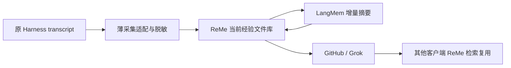

### assistant
Message Type: MESSAGE
Task name: /root
Sender: <redacted:user-path:ffee5fba72f5>
Payload:

### assistant
Message Type: FINAL_ANSWER
Task name: /root
Sender: <redacted:user-path:9a6ddc15bf0e>
Payload:
整体主线已经对准“廉价保存、检索和分享参考经验”，没有重新要求技术认证、强模型全文蒸馏或逐次审批。建议修改以下 5 处：

1. **[P1] 选型边界提前保护了现有核心，容易形成沉没成本偏见。**  
   [第 223 行](<redacted:local-path:b2119e8cd016>:223)先限定只能替换摘要和索引，[第 238 行](<redacted:local-path:b2119e8cd016>:238)又要求先修复现有核心，之后才比较框架。应改成：**保留产品合同，不预先保留其实现归属**；外部框架若能整体接管采集、队列或当前材料存储，并让我们删除更多代码，也可作为候选。将必要安全修复与离线框架比较并行，避免先重投旧实现再证明不值得替换。比较“现有修复成本＋长期维护”与“集成迁移成本＋长期维护”，不只数新增依赖。最终只能有一份权威状态，但隔离实验允许并行对照。

2. **[P1] 第 7 节把未确认的混合隐私处理扩成了新的必要模型能力。**  
   [第 145 行](<redacted:local-path:b2119e8cd016>:145)的“第一版两条输入通道”和“本地范围确认”没有具体入口，可能变成逐条人工判断；[第 147 行](<redacted:local-path:b2119e8cd016>:147)又把全量新增材料交给语义模型，可能重新引入用户反对的默认加工成本。建议第一版只明确：使用已保存的共享范围、既有脱敏规则，已知不属于范围的材料阻止出站；**混合材料自动语义脱敏列为未承诺扩展，不作为默认闭环前置要求**。保留已经复现的跨段脱敏修复，它有具体故障依据。

3. **[P1] “确认后清理”和“main 到达前保留唯一正文”尚有冲突。**  
   [第 183 行](<redacted:local-path:b2119e8cd016>:183)说冻结内容明确回执后清理，[第 187 行](<redacted:local-path:b2119e8cd016>:187)又要求主线发布前保留；“回执”可能仅确认分支/PR 写入，不能据此删除唯一当前成果。建议直接列三种当前材料：**当前公开版本、当前未合并候选/补充、结果未知操作所需的冻结版本**；它们可以暂时并存，但不保留每轮历史。分别写明 PR open、merged、closed-unmerged、bot 改稿、用户删除草稿时哪份保留/清理。旧引用过期的方向正确，无须恢复永久旧正文。

4. **[P2] 缓存条件要求“相同正文”，会让首尾/抽样策略重新支付无意义模型调用。**  
   [第 135 行](<redacted:local-path:b2119e8cd016>:135)应拆成两个条件：**模型结果复用键绑定实际模型输入、提示词/策略、模型配置和授权范围；结果应用绑定当前正文版本及重新核对的覆盖范围**。正文在未选区域变化、实际摘要输入完全相同时，可以明确复用既有结果并重绑当前正文回执，不伪称新调用或完整覆盖。修复 worker 指纹缺失没有必要同时取消既有的输入相同复用收益。

5. **[P2] 补一张最小闭环操作表，并为模型 unknown 留下能执行的终点。**  
   [第 172 行](<redacted:local-path:b2119e8cd016>:172)要求先确定模型是否执行过，但很多模型通道无法查询历史请求结果；不能因此永久卡死。应规定：结果可取则复用；不可取则保留已可能消费的预算与原尝试，允许用户明确请求新的摘要尝试，不重置旧账。闭环验收至少写清一次合成任务的唯一标记、原生事件回执、摘要实际模型及用量、最终 bot-reviewed head、main commit、**无贡献者草稿/数据库的第二客户端**读取结果；再各做一次后续更正、停用和未知写核对。Grok 修改过内容时核对最终审阅版本，不要求与贡献者原始候选逐字相同。当前链接的评估/选型文件尚未存在，最终交付前补齐即可，不能先称测试合同完整。

全局选型挑战是：**我们需要证明保留当前组件更省维护，而不是要求外部框架证明自己能适配当前组件的一切内部结构。** 授权一次、错误可见、GitHub 内容权威、参考性和成本可控是不可丢的合同；现有数据库、状态机、模块边界都可以被替换。

### assistant
Message Type: MESSAGE
Task name: /root
Sender: <redacted:user-path:9375ef055577>
Payload:

### assistant
Message Type: MESSAGE
Task name: /root
Sender: <redacted:user-path:ffee5fba72f5>
Payload:

### assistant
Message Type: FINAL_ANSWER
Task name: /root
Sender: <redacted:user-path:9375ef055577>
Payload:
调研完成，报告在 [framework-comparison.md](<redacted:local-path:db038484c95c>)，含 30 个固定 commit 源码和测试链接。

- **Basic Memory：优先局部实验。** Markdown、本地 SQLite、增量检索最接近需求；但完整产品包含数据库正文、写入同步状态机、较重依赖及 AGPL 许可边界。适合限制为可重建检索缓存。
- **Mem0：不推荐主链接入。** 默认抽取涉及 LLM、embedding、已有记忆和最近消息；删除仍保留旧正文 history。模型响应解析失败仍可能返回空列表，实体清理错误被吞掉。`infer=False` 后主要收益剩下向量后端适配。
- **Hindsight：留作独立推理实验。** 替换、删除级联、去重及失败重试有较完整测试源码；但 `pg0` 是真实 PostgreSQL 服务，默认事实抽取、后台合并和历史快照增加模型与运行成本。
- **OpenMemory：必须区分新旧产品。** 原 MCP/dashboard 已明确归档；当前主线是跨 Harness 会话迁移 CLI。其修订标识采用轮数，同轮数正文更正可能被跳过，不适合知识修订协议。

没有候选能直接提供 MindIE 整套脱敏、多人贡献、Git 分发、反馈和精确修订来源链。所有结论来自当前官方代码及文档；上游测试只阅读未执行，没有真实质量、时延或费用测量。

### assistant:commentary
外部调研里有两个值得深入验证的方向：LangMem 的独立摘要函数可能接管增量摘要逻辑；ReMe 和 Basic Memory 的 Markdown 检索可以作为现有检索的替换候选。

也发现了一些旧资料会误导选型：当前 OpenMemory 已改为会话迁移工具；ACE 输出局部修改，但整理时仍读取整份 playbook。我会补做一次 LangMem 的隔离接口试接，验证能否复用它的摘要函数而不接入整套存储和调度；模型效果和实际费用仍需单独测量。

### assistant
Message Type: MESSAGE
Task name: /root
Sender: <redacted:user-path:ffee5fba72f5>
Payload:

### user
细节部分后面实现的时候再细看，先敲定和设计好整个宏观层面的东西，不然就会一直返工，我需要系统性的设计和调研，能够满足将transcript高效、并且系统性的收集起来并复用的模块，有成熟的组件就直接复用并魔改，如果一个不行就复用多个然后魔改，我需要的是系统性的搞定这个核心任务

### assistant
Message Type: MESSAGE
Task name: /root
Sender: <redacted:user-path:ffee5fba72f5>
Payload:

### assistant:commentary
明白，这轮先把宏观方案定下来。已发现的代码问题会作为架构约束和验收依据，不再沿着逐项修补展开。

我会把主线收敛到：transcript 怎样持续进入、以什么单位形成可复用材料、怎样低成本整理长任务、怎样检索和跨用户分发，以及各段由哪些现成组件承担。会给出明确的组件组合、需要改造和舍弃的部分、完整的数据流，并区分现在应定下的架构与实现时再测的参数。

### assistant
Message Type: FINAL_ANSWER
Task name: /root
Sender: <redacted:user-path:9a6ddc15bf0e>
Payload:
**推荐 A 作为宏观基线：ReMe 做文件知识库与检索，LangMem 做增量摘要，GitHub/Grok 做共享与维护。** 目标是替换成块的自研职责，而不是给现有完整核心再加两个依赖。

| 组合 | 宏观判断 |
|---|---|
| **A：ReMe＋LangMem＋GitHub/Grok** | 职责最容易分清：采集已有经历、管理文件、更新摘要、共享复用。能够同时减少自研存储/检索和摘要编排，推荐。 |
| **B：深改 ReMe 完整 auto_memory** | 包数量少，但要改掉 raw copy、文件 Agent 多轮编辑、tag、dream 等原有流程，容易长期维护一个与上游方向不同的分叉。适合作为 A 中摘要模块不合适时的收缩方案。 |
| **C：现有核心＋LangMem＋FTS** | 改动最小，但材料存储、生命周期、索引和跨状态管理仍由我们维护。可作比较基线，不能仅因已有代码就优先选择。 |

A 必须明确以下裁剪：

- **ReMe 接管**当前经验文件管理、派生索引、查询和文件变化处理；删除现有核心中被覆盖的正文存储与索引管理职责。
- **关闭 ReMe** 的原始 transcript 复制、auto_memory、auto_tag、dream/proactive 等自动演化路径；不要引入私人偏好、日记、digest 多层流程。
- **LangMem 只负责**将新增材料与必要既有摘要变成新的检索摘要；不同时拥有正文库存、另一套检索或自动上下文注入。
- **自研只保留薄边界**：各 Harness 的授权增量投影、必要脱敏，以及既有 GitHub 发布操作回执。不要保留完整旧核心作为框架之间的总编排层。
- 原始 transcript 留在 Harness；共享材料保存当前有效版本；摘要是派生物。此时先不决定新的分块、manifest 或引用计数协议，优先让框架和 Git 承担已有能力。

需要确认的宏观假设只有两个：**LangMem 能否作为不带第二库存的摘要模块；ReMe 能否直接管理我们的经验文件并真正替掉现有材料/索引层。** 如果为了接它们还需要重写大量存储和协调代码，A 就没有达成复用目的，应收缩组合，而不是继续堆适配层。摘要质量与总成本目前仍未实测。

前一项研究附件已写入：[research-reme-ace-claudemem.md](<redacted:local-path:4c3cddda4002>)，仅新增该文件。

### assistant
Message Type: MESSAGE
Task name: /root
Sender: <redacted:user-path:9375ef055577>
Payload:

### assistant
Message Type: MESSAGE
Task name: /root
Sender: <redacted:user-path:9375ef055577>
Payload:

### assistant
Message Type: MESSAGE
Task name: /root
Sender: <redacted:user-path:ffee5fba72f5>
Payload:

### assistant
Message Type: FINAL_ANSWER
Task name: /root
Sender: <redacted:user-path:9375ef055577>
Payload:
建议直接定为 **ReMe + LangMem + Git/GitHub + Gitleaks，MindIE 只保留宿主采集、授权、脱敏交接和发布回执适配**。Basic Memory、Hindsight 都不替换其中任何一段；它们会增加重叠的材料管理或推理系统。

| 层 | 权威与职责 |
|---|---|
| 原始记录 | Harness 自己的 transcript 是唯一原始档案。MindIE 增量读取，保存必要游标与来源映射，不另建完整原始会话库。 |
| 当前可分享材料 | ReMe 管理唯一一份当前工作区：完整脱敏正文、来源关系和小模型索引。它负责文件变化、检索及可重建索引，不独立生成另一套“事实记忆”。 |
| 小模型加工 | LangMem 只接收新增或变化的完整材料批次，以及有界旧导航索引，产出局部检索索引和更新后的任务导航。没有第二个材料库存。 |
| 公共发布 | GitHub 上的普通文件经验包是已发布正文与版本的权威；Git 负责版本、贡献与增量传输。这里的权威不代表内容已被认证为正确知识。 |
| 消费与维护 | 消费者通过 ReMe 查询，定位后读取对应完整正文。Grok 维护公共目录、关联、标签和修订，避免默认重新摘要所有正文。 |

**分享单位采用“任务经验包”，内部按稳定结构片段增长。**

整 session 是完整性和来源归属单位；稳定消息组或任务片段是增量处理单位；主题条目是检索入口，指回正文。三者不是三选一。这样既不会每多一轮就重做整个长 session，也不会把每条 turn 单独包装成无上下文的经验。

经验包应保留有序的完整脱敏材料及派生索引。结束、失败、未完成都是合法状态；任务结束无需再进行一次全文模型合并。物理上使用 ReMe 能管理的普通 Markdown 文件和轻量目录关系即可，**不要另造内容寻址存储、引用计数服务或分发协议**。

避免重复工作应在三个位置解决：

1. **采集端：** 原始消息归属与内容变化可识别，只处理新增或变化材料。
2. **模型端：** 按内容摘要和处理版本复用结果。生产者的小模型索引随包发布，消费者直接使用；同一材料无需每个用户重新生成摘要。语义相似只能建立关联，不能据此丢弃原文。
3. **同步端：** 同一公共仓库共用一个持久 Git 缓存，复用已下载对象；客户端按已知发布版本更新，只重建变化材料的本地检索缓存。是否采用部分克隆、何时下载正文属于后续性能选择。

Gitleaks 适合作为已脱敏材料的检测关卡，不能独自承担身份、路径和上下文隐私脱敏；这一小段确定性投影仍属于 MindIE 适配责任。

**现在必须确定：** 上述数据权威与职责；不复制原始档案；完整脱敏材料保留；任务包、增量片段和派生索引的关系；公共索引可复用但可错；修订必须关联来源并使旧检索结果失效；所有模型加工有边界。

**留待测量：** 片段大小、小模型与预算、批次并发、检索混合方式、下载粒度、同步频率和缓存保留参数。现在不需要先定这些数值，也不需要为它们新增一套自研框架。

### assistant
Message Type: MESSAGE
Task name: /root
Sender: <redacted:user-path:ffee5fba72f5>
Payload:

### assistant
Message Type: FINAL_ANSWER
Task name: /root
Sender: <redacted:user-path:ffee5fba72f5>
Payload:
推荐采用 **LangMem 增量索引 + ReMe Markdown 检索 + GitHub 经验包 + Grok 增量目录维护**。

宏观机制已经写入[框架报告](<redacted:local-path:902e237aa60a>)：

- 持续采集完整脱敏正文，以有序结构块组成任务经验包。
- 小模型每次读取完整新增批次和短 running index，一次生成块索引及任务导航索引。
- 保存块索引，结束仅处理剩余增量，无最终全文 merge。
- 索引随正文发布；消费者复用索引，避免重复摘要全部他人内容。
- GitHub 发布版本是共享权威；ReMe 索引可重建；Grok 维护目录和关联。

[LangMem 隔离试接](<redacted:local-path:624fa72e2594>)已验证无数据库接入、每批一次调用及 title/summary 单次生成机制，也复现了内置 trim 漏读风险。安装共 50 个包、约 44.38 MiB 文件。全部使用 fake 模型；真实质量、费用和预算参数仍待测。已停止新增测试。

### assistant:commentary
宏观方案已收敛为 **ReMe＋LangMem＋GitHub/Grok**：ReMe 接管当前经验文件和检索，LangMem 负责用户侧小模型增量索引，MindIE 保留宿主接入与共享所需的边界。

分享单位确定为“任务经验包”，内部按稳定材料块增长，索引随正文一起发布。消费者直接复用发布者生成的索引，不必各自重新摘要。这样完整性、增量成本和跨用户复用能落在同一条流程里；批次大小、提示词和缓存参数留到实现时测。

### assistant:final_answer
**宏观方案建议定为：ReMe＋LangMem＋GitHub/Grok，组成一个统一的 transcript 采集与复用模块。**

三个子代理已经按当前官方源码比较了九个框架。选型原则是让成熟组件接管完整职责，并删除被替代的自研部分。

