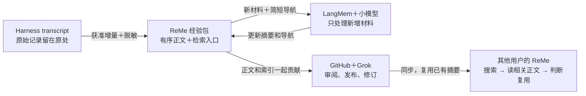

| 部分 | 职责 |
|---|---|
| **[ReMe](https://github.com/agentscope-ai/ReMe)** | 管理当前 Markdown 经验材料、索引和检索 |
| **[LangMem](https://github.com/langchain-ai/langmem)** | 用用户侧小模型处理新增材料，持续更新检索摘要 |
| **GitHub＋现有 Grok** | 贡献、分发、审阅和增量维护 |
| **MindIE 适配层** | Harness 接入、授权范围、增量采集、脱敏与操作回执 |

**数据单位确定为“任务经验包”。** 一个包保存任务的有序材料，内部按稳定的消息块增长，同时保留各块检索入口和当前任务导航。这样既能理解整个任务，也能直接找到长任务中间的某次失败、发现或纠正。

处理流程确定为：

**获准 transcript 增量 → 脱敏材料块 → 小模型一次生成检索入口 → 经验包持续更新 → GitHub 发布 → 其他客户端检索复用。**

其中有四个关键取舍：

- **每批只处理完整新增材料和简短导航。** 不每轮重读累计全文，结束时也不追加一次全文合并。
- **正文和摘要分开。** 正文保留失败、误判及更正；摘要负责帮助找到材料，不承担技术认证。
- **索引随正文一起分享。** 消费者复用贡献者生成的摘要，只重建本地检索结构，避免每个人重新总结同一份内容。
- **只保留当前有效材料。** 原始记录留在 Harness，不复制进另一套会话档案，不保存每轮正文快照。

复用也需要明确裁剪：关闭 ReMe 默认的原始记录复制、多轮自动写作和记忆演化；LangMem 不另建库存；现有正文数据库与检索管理在职责被接管后退出，避免几套系统长期重叠。

后续验收围绕五件事：**收集范围正确、整理成本可控、经验找得到且读得懂、独立客户端分享闭环成立、失败后不会丢材料或重复收费。** 分块大小、提示词、模型参数和缓存期限留到实现时测，不再反复改变这些宏观边界。

完整材料已整理好：

- **[宏观架构与组件组合](<redacted:local-path:3c52ef3e973d>)** — 后续实现的主线。
- **[九个框架的系统评估](<redacted:local-path:ea13af95139f>)** — 采用、改造和舍弃的依据。

LangMem 已完成隔离接口试接，证明可以不增加数据库接入；真实摘要质量、费用和 ReMe 接管仍待集成验收。本轮没有改动生产组件。


### user
用一幅图或者别的尽可能精简的方式向我阐述这个方案，让我确认这是一个可行的方案


### assistant:final_answer
**核心是：保存可分享的经历，小模型建立检索入口，GitHub 分发，后来者按需阅读。**



这套方案的三个关键点：

- **长任务持续追加**：不反复重读整份 transcript，结束时也不再全文总结一次。
- **正文保留经历，摘要帮助查找**：失败、误判和更正都能保存，摘要不是唯一存档。
- **整理一次，多人复用**：消费者不重新总结别人的材料，也不需要我们运营中心模型或数据库服务。

**架构上有明确的落地路径。** LangMem 的独立接口已经试通；ReMe 接管文件与检索，以及真实摘要质量、累计费用，仍需用“一条长任务 → GitHub → 独立客户端复用”验证。通过这条闭环后再扩大规模。

### user
总结部分的开销是怎么算的，大体的策略是什么


### assistant:final_answer
**主要按累计输入、输出 token 算。策略是：每段新增材料正常只读一次，每批额外携带一份很短的任务导航。**

一次处理大致是：

```text
新增材料 + 当前简短导航
          ↓ 一次小模型调用
本批检索摘要 + 更新后的任务导航
```

同一次调用完成两个输出，不增加一次“总结所有摘要”的调用。完整正文直接保存，不让模型重新写一遍。

总开销可以拆成：

- **输入量** ≈ 全部新增材料 ＋ 各批重复携带的短导航 ＋ 固定提示词。
- **输出量** = 各批生成的摘要、导航之和。
- **实际费用** = 输入和输出量按实际模型价格计费；缓存、失败和重试另行计入。使用订阅额度时，也要记录用量和耗时。

举个纯计算例子：一场任务产生 **10 万 token** 的获准材料，分 **10 批**处理，每次携带 **1,000 token** 的旧导航：

| 策略 | 累计输入量，不含固定提示和输出 |
|---|---:|
| 每批重新总结截至目前的全文 | 55 万 token |
| 新增材料＋短导航 | 约 **10.9 万 token** |
| 等任务结束，全文只总结一次 | 10 万 token |

所以，**增量处理主要消除反复阅读全文的浪费**。短任务可以等结束后一次处理；长任务通过分批获得持续可用的索引，并避开单次上下文窗口限制。

控制成本的方式也很明确：

1. 合并零散消息，不每次 Stop 都调模型。
2. 用小模型建立检索入口，不做技术真实性认证或全文改写。
3. 旧导航保持短小，详细信息留在正文和各块索引。
4. 成功结果复用；发布失败、重新同步不重新总结。
5. 摘要随经验包分享，其他用户直接复用，不重复付费生成。

**目前这还是成本模型，真实摘要质量和费用尚未测出。** 后续应看“每份经验包的累计成本，以及能否帮助下一次任务”，不能只凭调用次数少或请求体小判断便宜。

### user
按照这个实现吧，实现的时候兼顾一下历史经验的导入也带上，最好直接复用一套逻辑，直接推进到完整落地


### assistant:commentary
我会按这套架构推进实现，把日常增量采集和显式历史导入接到同一条处理管线，并验证到独立客户端复用。先确认各仓库和候选改动的状态，在隔离工作树中集成，保留现有未提交工作。


### user
历史导入直接用我k3相关开发的长任务作为系统级测试用例，所有的测试以真实的case为前提进行构造并正交化，不需要考虑历史兼容直接一步到位


### assistant:commentary
收到。我会用 K3 开发长任务验证历史导入，并从其中的实际故障和流程构造正交测试；实现直接切到新架构。原始会话由本地导入流程读取，传给模型或进入共享流程前先完成脱敏。


### assistant
Message Type: MESSAGE
Task name: /root
Sender: <redacted:user-path:ffee5fba72f5>
Payload:


### assistant
Message Type: MESSAGE
Task name: /root
Sender: <redacted:user-path:9375ef055577>
Payload:


### assistant
Message Type: MESSAGE
Task name: /root
Sender: <redacted:user-path:9a6ddc15bf0e>
Payload:


### assistant:commentary
实现已经拆成三个并行部分：ReMe 文件与检索、LangMem 增量索引、经验包发布与消费。我来打通实时采集和历史导入，并选取 K3 长任务；两条入口会使用同一套分块、脱敏、摘要和恢复逻辑。


### assistant
Message Type: MESSAGE
Task name: /root
Sender: <redacted:user-path:9a6ddc15bf0e>
Payload:


### assistant
Message Type: MESSAGE
Task name: /root
Sender: <redacted:user-path:9375ef055577>
Payload:


### assistant
Message Type: MESSAGE
Task name: /root
Sender: <redacted:user-path:ffee5fba72f5>
Payload:


### assistant
Message Type: MESSAGE
Task name: /root
Sender: <redacted:user-path:9a6ddc15bf0e>
Payload:


### assistant
Message Type: MESSAGE
Task name: /root
Sender: <redacted:user-path:9375ef055577>
Payload:


### assistant
Message Type: MESSAGE
Task name: /root
Sender: <redacted:user-path:9375ef055577>
Payload:


### assistant
Message Type: MESSAGE
Task name: /root
Sender: <redacted:user-path:9a6ddc15bf0e>
Payload:


### assistant
Message Type: MESSAGE
Task name: /root
Sender: <redacted:user-path:ffee5fba72f5>
Payload:


### assistant:commentary
已选出四个真实 K3 长任务，覆盖模型适配、性能测试后的权重纠正、Prefix Cache 调查和续接精度定位。原始记录合计约 249 MB，公开消息投影约 1.15 MB；当前解析器已完整读到各自快照末尾，未报告格式缺口。接下来会分别验证中段发现与纠正的保留、增量续接、失败恢复和独立客户端检索。


### assistant
Message Type: MESSAGE
Task name: /root
Sender: <redacted:user-path:ffee5fba72f5>
Payload:


### assistant
Message Type: MESSAGE
Task name: /root
Sender: <redacted:user-path:9a6ddc15bf0e>
Payload:


### assistant
Message Type: MESSAGE
Task name: /root
Sender: <redacted:user-path:9a6ddc15bf0e>
Payload:


### assistant
Message Type: MESSAGE
Task name: /root
Sender: <redacted:user-path:9375ef055577>
Payload:


### assistant
Message Type: MESSAGE
Task name: /root
Sender: <redacted:user-path:9375ef055577>
Payload:


### assistant
Message Type: MESSAGE
Task name: /root
Sender: <redacted:user-path:ffee5fba72f5>
Payload:


### assistant
Message Type: MESSAGE
Task name: /root
Sender: <redacted:user-path:9a6ddc15bf0e>
Payload:


### assistant:commentary
两条入口现在已共用增量处理模块，历史导入也改为逐页提交。它会记录已处理位置和跨页脱敏状态；重复导入先核对已读部分是否变化，再处理新增内容。存储正在切到当前 Markdown 文件，SQLite 只保留游标、队列和回执。


### assistant
Message Type: MESSAGE
Task name: /root
Sender: <redacted:user-path:9a6ddc15bf0e>
Payload:


### assistant
Message Type: MESSAGE
Task name: /root
Sender: <redacted:user-path:9a6ddc15bf0e>
Payload:


### assistant
Message Type: MESSAGE
Task name: /root
Sender: <redacted:user-path:9375ef055577>
Payload:


### assistant
Message Type: MESSAGE
Task name: /root
Sender: <redacted:user-path:9375ef055577>
Payload:


### assistant
Message Type: MESSAGE
Task name: /root
Sender: <redacted:user-path:9375ef055577>
Payload:


### assistant
Message Type: MESSAGE
Task name: /root
Sender: <redacted:user-path:ffee5fba72f5>
Payload:


### assistant:commentary
摘要调用已接上逐批回执：模型返回后先保存结果和用量，再做本地扫描与应用；扫描失败时复用已返回结果，调用结果不确定时暂停该批，避免重复收费。接下来我会按 `openai-docs` 技能核对本机 Codex 小模型调用方式，并开始真实摘要验证。


### assistant
Message Type: MESSAGE
Task name: /root
Sender: <redacted:user-path:9a6ddc15bf0e>
Payload:


### assistant
Message Type: MESSAGE
Task name: /root
Sender: <redacted:user-path:9375ef055577>
Payload:


### assistant
Message Type: MESSAGE
Task name: /root
Sender: <redacted:user-path:9a6ddc15bf0e>
Payload:


### assistant
Message Type: MESSAGE
Task name: /root
Sender: <redacted:user-path:ffee5fba72f5>
Payload:


### assistant
Message Type: MESSAGE
Task name: /root
Sender: <redacted:user-path:9a6ddc15bf0e>
Payload:


### assistant
Message Type: MESSAGE
Task name: /root
Sender: <redacted:user-path:9375ef055577>
Payload:


### assistant
Message Type: MESSAGE
Task name: /root
Sender: <redacted:user-path:ffee5fba72f5>
Payload:


### assistant
Message Type: MESSAGE
Task name: /root
Sender: <redacted:user-path:9a6ddc15bf0e>
Payload:


### assistant
Message Type: MESSAGE
Task name: /root
Sender: <redacted:user-path:9a6ddc15bf0e>
Payload:


### assistant
Message Type: MESSAGE
Task name: /root
Sender: <redacted:user-path:9a6ddc15bf0e>
Payload:


### assistant
Message Type: MESSAGE
Task name: /root
Sender: <redacted:user-path:ffee5fba72f5>
Payload:


### assistant:commentary
四个 K3 任务已实际导入；再次导入均为零新增、零模型调用。真实材料暴露了中文口令标签和脱敏占位符被重复识别的问题，修正后四份材料均通过现有规则复扫。

小模型调用也已跑通：当前 CLI 账号支持原方案的 `gpt-5.6-luna`；一次纠错场景验证用了 8,777 输入 token、186 输出 token，约 12 秒。我据此调大了新增批次的输入上限，减少长任务反复支付的固定提示开销。


### assistant
Message Type: MESSAGE
Task name: /root
Sender: <redacted:user-path:9a6ddc15bf0e>
Payload:


### assistant
Message Type: MESSAGE
Task name: /root
Sender: <redacted:user-path:9375ef055577>
Payload:


### assistant
Message Type: MESSAGE
Task name: /root
Sender: <redacted:user-path:ffee5fba72f5>
Payload:


### assistant
Message Type: MESSAGE
Task name: /root
Sender: <redacted:user-path:9375ef055577>
Payload:


### assistant:commentary
首个真实 K3 历史批次已通过原生模型完成摘要，调用记录和材料索引都已落盘，耗时约 29 秒。我会继续跑完四个长任务，并检查检索能否找回中段信息、纠错过程和未完成结论。

### assistant
Message Type: MESSAGE
Task name: /root
Sender: <redacted:user-path:9a6ddc15bf0e>
Payload:


### assistant
Message Type: MESSAGE
Task name: /root
Sender: <redacted:user-path:9375ef055577>
Payload:


### assistant
Message Type: MESSAGE
Task name: /root
Sender: <redacted:user-path:9a6ddc15bf0e>
Payload:


### assistant
Message Type: MESSAGE
Task name: /root
Sender: <redacted:user-path:9375ef055577>
Payload:


### assistant:commentary
连续四个真实批次已完成，暂未出现重复调用或未知计费结果。同时修正了两处状态判断：未构建的 ReMe 索引会显示为未就绪；已有到期摘要待处理时，服务不会被判为空闲退出。

### assistant
Message Type: MESSAGE
Task name: /root
Sender: <redacted:user-path:9375ef055577>
Payload:


### assistant
Message Type: MESSAGE
Task name: /root
Sender: <redacted:user-path:ffee5fba72f5>
Payload:


### assistant:commentary
第一个 K3 长任务已完成全部材料索引，其余三个仍在处理。并发场景也按新合同调整了：新材料到达时，已完成的摘要可以继续用于它对应的稳定材料块；新增块仍需单独索引，整个任务不会被提前标记为完成。

### assistant
Message Type: MESSAGE
Task name: /root
Sender: <redacted:user-path:9375ef055577>
Payload:


### assistant
Message Type: MESSAGE
Task name: /root
Sender: <redacted:user-path:ffee5fba72f5>
Payload:


### assistant
Message Type: MESSAGE
Task name: /root
Sender: <redacted:user-path:9a6ddc15bf0e>
Payload:


### assistant
Message Type: MESSAGE
Task name: /root
Sender: <redacted:user-path:9375ef055577>
Payload:


### assistant
Message Type: MESSAGE
Task name: /root
Sender: <redacted:user-path:9a6ddc15bf0e>
Payload:


### assistant:commentary
历史导入和日常采集的 63 个管线测试已通过。检查中又补了一处发布边界：历史快照若在后半段损坏，前面已保存的材料会保留供恢复，但不能发布；必须显式续导入并完整读到所选快照末尾，才解除该限制。

### assistant
Message Type: MESSAGE
Task name: /root
Sender: <redacted:user-path:ffee5fba72f5>
Payload:


### assistant
Message Type: MESSAGE
Task name: /root
Sender: <redacted:user-path:ffee5fba72f5>
Payload:


### assistant
Message Type: MESSAGE
Task name: /root
Sender: <redacted:user-path:9a6ddc15bf0e>
Payload:


### assistant
Message Type: MESSAGE
Task name: /root
Sender: <redacted:user-path:ffee5fba72f5>
Payload:


### assistant
Message Type: MESSAGE
Task name: /root
Sender: <redacted:user-path:9375ef055577>
Payload:


### assistant
Message Type: MESSAGE
Task name: /root
Sender: <redacted:user-path:9a6ddc15bf0e>
Payload:


### assistant
Message Type: MESSAGE
Task name: /root
Sender: <redacted:user-path:9a6ddc15bf0e>
Payload:


### assistant:commentary
前三个真实 K3 长任务已完成索引。导航中保留了几个关键区别：197/198 的中止结果没有写成完整跑完，错误 checkpoint 的结果被标为作废，prefix cache 卡死的未证实根因也没有写成定论。接下来用这些具体信息检查实际检索结果。

