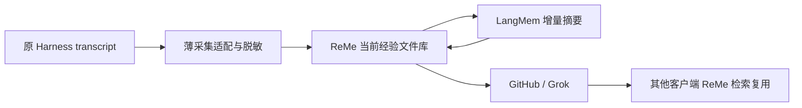

- **实际工作流。** Python ≥3.10，依赖 OpenAI/Together/SambaNova、FAISS、sentence-transformers、tiktoken 等；公开 Python 类为 `ACE/ACEBatch/Generator/Reflector/Curator`。主要 runner 面向 offline/online adaptation 与评测，没有看到官方通用 Harness Hook、Git 发布或独立 MCP/HTTP 组件。[包/API](https://github.com/ace-agent/ace/blob/82709de050e1db6e6ef2f07bcb0393560b94992a/ace/__init__.py)、[依赖](https://github.com/ace-agent/ace/blob/82709de050e1db6e6ef2f07bcb0393560b94992a/pyproject.toml)。
- **调用成本。** 常规成功训练样本也会生成答案、反思、整理、再次生成；失败样本可多轮反思并重新生成。即便外部提供业务结果而只复用 Reflector＋Curator，仍至少需要两个角色调用。Curator 每次输入包含完整 `current_playbook`，Generator 也读 playbook；delta 节省的是修改方式和输出，不保证每次输入便宜。[训练循环](https://github.com/ace-agent/ace/blob/82709de050e1db6e6ef2f07bcb0393560b94992a/ace/ace.py)、[Curator](https://github.com/ace-agent/ace/blob/82709de050e1db6e6ef2f07bcb0393560b94992a/ace/core/curator.py)。
- **实现边界。** 文档提到 UPDATE/MERGE/DELETE，但 `apply_curator_operations` 当前只实施 `ADD`，其余标为 TODO。另有可选 BulletpointAnalyzer 用全 playbook embeddings 分组、额外 LLM 合并；这不等同完整、有修订保护的 delta 编辑协议。[实际操作](https://github.com/ace-agent/ace/blob/82709de050e1db6e6ef2f07bcb0393560b94992a/playbook_utils.py)、[额外整理](https://github.com/ace-agent/ace/blob/82709de050e1db6e6ef2f07bcb0393560b94992a/ace/core/bulletpoint_analyzer.py)。
- **持久与错误。** 主要输出 playbook 文本、逐步快照、完整 LLM prompt/response 日志；没有 Git 主权或自动保留期限。Curator JSON 失败时记录日志并返回旧 playbook 与空 operations；调用者要额外区分“失败”和“合法无变化”。`timed_llm_call` 默认超时/限流/服务错误尝试上限为 1000，不符合我们的有限自动成本要求。[LLM 调用](https://github.com/ace-agent/ace/blob/82709de050e1db6e6ef2f07bcb0393560b94992a/llm.py)、[日志](https://github.com/ace-agent/ace/blob/82709de050e1db6e6ef2f07bcb0393560b94992a/logger.py)。
- **隐私与质量语义。** 接口直接接收 reasoning trace、问题、环境反馈等；不能接入隐藏推理或未经脱敏的记录。helpful/harmful 计数、反思迭代旨在改进任务表现，与“错误经验照样可作参考”不同。该快照主要见评测 runner/数据，未见独立 `tests/`；论文任务得分不是本组件的检索摘要验收。

**建议复用位置：**Grok 已获准维护某个条目时，借鉴“给出局部新增/更正、保留旧条件、确定性应用”的方法；用现有 Git diff/PR 即可，不必引入整套 ACE、评分或额外 Reflector。直接整合所需的隐私、预算、错误、版本、持久清理改造明显多于可删除的现有实现。

**claude-mem：跨 Harness 已较完整，但保存目标和成本结构不同**

- **依赖及状态。** 当前支持 Codex 等多 Harness；本地 worker 使用 Node ≥20.12、Bun ≥1.1.31，SQLite 保存 sessions/prompts/observations/summaries；Chroma 默认开启，可关闭为 SQLite-only，本地向量链路使用 uv。运行时还有队列、observer 会话、spool、索引等状态；Git Markdown 不是其权威层。[当前配置](https://github.[REDACTED_SECRET].ts)、[运行依赖](https://github.com/thedotmack/claude-mem/blob/bfc50259f64a4e0c9e81df849095683608e87ac8/plugin/package.json)。
- **模型工作。** Hook/日志观察工具事件，模型生成 observation，Stop 再生成 summary。Claude 路径复用 SDK 会话；OpenAI-compatible/Codex 路径每次重送保留的观察历史。现实现已把较早、处理完的原始工具载荷替换为短标记，保留最近 8 条及助手观察，并按字符/上下文阈值回收会话；所以不能批评成当前无界重送所有原始工具输出。但超大工具字段会先单独调用模型压缩，成本包括 init、observations、summary、压缩及允许的重试。[历史裁剪](https://github.com/thedotmack/claude-mem/blob/bfc50259f64a4e0c9e81df849095683608e87ac8/src/services/worker/history-pruning.ts)、[观察模型实现](https://github.[REDACTED_SECRET].ts)、[Codex 批处理](https://github.[REDACTED_SECRET].ts)。
- **可嵌入点。** MCP `search → timeline → get_observations` 和 HTTP `/api/memory/save` 可消费外部材料；有按观察、summary、prompt、session 删除 API。若把它只用作检索，又需要把 Git 条目映射为 SQLite observation，并维护双向修订/撤回语义，增加第二套权威映射。[Memory API](https://github.[REDACTED_SECRET].ts)、[读取删除 API](https://github.[REDACTED_SECRET].ts)。
- **错误处理比简单后台摘要完善。** 有 transient/unrecoverable、quota、ambiguous paid-send 等分类、保留待处理批次、调用者提示的 observer-health 状态；有专门 Codex 失败记账测试。这值得借鉴，但我们尚未运行这些测试，也没有验证用户宿主展示。[错误合同](https://github.com/thedotmack/claude-mem/blob/bfc50259f64a4e0c9e81df849095683608e87ac8/src/services/worker/provider-errors.ts)、[相关测试](https://github.com/thedotmack/claude-mem/blob/bfc50259f64a4e0c9e81df849095683608e87ac8/tests/worker/codex-failure-booking.test.ts)。
- **出站默认必须区分。** 本地配置的 cloud sync 默认关闭，不能说安装就上传全部历史；但交互安装默认推荐 hosted CMEM observer，模型本来就可能出站。自动 secret redaction 当前默认关闭，`<private>` 标签过滤始终不等于我们的主动扫描；匿名遥测默认开启，可退出，源码有字段白名单和错误脱敏，不能把它描述为上传原始会话。[默认配置](https://github.[REDACTED_SECRET].ts)、[脱敏](https://github.com/thedotmack/claude-mem/blob/bfc50259f64a4e0c9e81df849095683608e87ac8/src/utils/redaction.ts)、[遥测开关](https://github.com/thedotmack/claude-mem/blob/bfc50259f64a4e0c9e81df849095683608e87ac8/src/services/telemetry/consent.ts)。
- **清理。** 有显式删除、队列清理和多类恢复逻辑；本轮未证实统一的 observation/session 自动 TTL。持久跨会话记忆本身就是目标，不能把它看作“成功上传 GitHub 即清理本地正文”的现成实现。

**建议复用：**分层检索让调用者先看短卡片、再读时间上下文/正文；队列的失败分类和批处理边界也值得参考。但我们已有主要队列与检索组件，整体接入会增加 worker、数据库、向量与模型配置以及默认行为治理，且仍然需要自己保留 GitHub 发布链路。

最小验证建议只做两件事：

1. **ReMe 检索替换实验**：同一公开合成 Markdown 语料，同一查询，对比现有 FTS 与 ReMe BM25＋链接扩展的 <redacted:username-at-host:8af2a1e50a32>、选读准确率、冷启动、内存、索引磁盘和删除传播；完全不调用整理模型。只有改善了当前真实缺口，才继续嵌入。
2. **保留前述四种小模型摘要对照**：这些框架没有免除这项验证。把 ReMe `auto_memory` 或 claude-mem observation 作为额外参赛者时，必须算入所有模型/工具轮次与旧摘要重送，并采用同一脱敏输入和最终输出预算。

我的判断是：**这轮最值得尝试复用的是文件检索能力；最不值得直接搬入的是强制自我改进、多层记忆演化和全套个人记忆运行时。** 它们提供了工程参考，但尚不能证明在我们的“共享参考经验”目标下更便宜或更好。

### assistant
Message Type: NEW_TASK
Task name: <redacted:user-path:9a6ddc15bf0e>
Sender: /root
Payload:

### assistant:commentary
我会按“廉价保存和复用参考经验”这条主线审查方案，重点找新增流程是否有必要，以及保存、删除和验收合同是否自洽。

### assistant:final_answer
整体主线已经对准“廉价保存、检索和分享参考经验”，没有重新要求技术认证、强模型全文蒸馏或逐次审批。建议修改以下 5 处：

1. **[P1] 选型边界提前保护了现有核心，容易形成沉没成本偏见。**  
   [第 223 行](<redacted:local-path:b2119e8cd016>:223)先限定只能替换摘要和索引，[第 238 行](<redacted:local-path:b2119e8cd016>:238)又要求先修复现有核心，之后才比较框架。应改成：**保留产品合同，不预先保留其实现归属**；外部框架若能整体接管采集、队列或当前材料存储，并让我们删除更多代码，也可作为候选。将必要安全修复与离线框架比较并行，避免先重投旧实现再证明不值得替换。比较“现有修复成本＋长期维护”与“集成迁移成本＋长期维护”，不只数新增依赖。最终只能有一份权威状态，但隔离实验允许并行对照。

2. **[P1] 第 7 节把未确认的混合隐私处理扩成了新的必要模型能力。**  
   [第 145 行](<redacted:local-path:b2119e8cd016>:145)的“第一版两条输入通道”和“本地范围确认”没有具体入口，可能变成逐条人工判断；[第 147 行](<redacted:local-path:b2119e8cd016>:147)又把全量新增材料交给语义模型，可能重新引入用户反对的默认加工成本。建议第一版只明确：使用已保存的共享范围、既有脱敏规则，已知不属于范围的材料阻止出站；**混合材料自动语义脱敏列为未承诺扩展，不作为默认闭环前置要求**。保留已经复现的跨段脱敏修复，它有具体故障依据。

3. **[P1] “确认后清理”和“main 到达前保留唯一正文”尚有冲突。**  
   [第 183 行](<redacted:local-path:b2119e8cd016>:183)说冻结内容明确回执后清理，[第 187 行](<redacted:local-path:b2119e8cd016>:187)又要求主线发布前保留；“回执”可能仅确认分支/PR 写入，不能据此删除唯一当前成果。建议直接列三种当前材料：**当前公开版本、当前未合并候选/补充、结果未知操作所需的冻结版本**；它们可以暂时并存，但不保留每轮历史。分别写明 PR open、merged、closed-unmerged、bot 改稿、用户删除草稿时哪份保留/清理。旧引用过期的方向正确，无须恢复永久旧正文。

4. **[P2] 缓存条件要求“相同正文”，会让首尾/抽样策略重新支付无意义模型调用。**  
   [第 135 行](<redacted:local-path:b2119e8cd016>:135)应拆成两个条件：**模型结果复用键绑定实际模型输入、提示词/策略、模型配置和授权范围；结果应用绑定当前正文版本及重新核对的覆盖范围**。正文在未选区域变化、实际摘要输入完全相同时，可以明确复用既有结果并重绑当前正文回执，不伪称新调用或完整覆盖。修复 worker 指纹缺失没有必要同时取消既有的输入相同复用收益。

5. **[P2] 补一张最小闭环操作表，并为模型 unknown 留下能执行的终点。**  
   [第 172 行](<redacted:local-path:b2119e8cd016>:172)要求先确定模型是否执行过，但很多模型通道无法查询历史请求结果；不能因此永久卡死。应规定：结果可取则复用；不可取则保留已可能消费的预算与原尝试，允许用户明确请求新的摘要尝试，不重置旧账。闭环验收至少写清一次合成任务的唯一标记、原生事件回执、摘要实际模型及用量、最终 bot-reviewed head、main commit、**无贡献者草稿/数据库的第二客户端**读取结果；再各做一次后续更正、停用和未知写核对。Grok 修改过内容时核对最终审阅版本，不要求与贡献者原始候选逐字相同。当前链接的评估/选型文件尚未存在，最终交付前补齐即可，不能先称测试合同完整。

全局选型挑战是：**我们需要证明保留当前组件更省维护，而不是要求外部框架证明自己能适配当前组件的一切内部结构。** 授权一次、错误可见、GitHub 内容权威、参考性和成本可控是不可丢的合同；现有数据库、状态机、模块边界都可以被替换。

### assistant
Message Type: NEW_TASK
Task name: <redacted:user-path:9a6ddc15bf0e>
Sender: /root
Payload:

### assistant:commentary
我会把已核对的源码机制、版本、依赖和取舍整理成研究附件，只新增指定文件，并保留“已读源码”与“尚未实测”的边界。

### assistant
Message Type: NEW_TASK
Task name: <redacted:user-path:9a6ddc15bf0e>
Sender: /root
Payload:

### assistant
Message Type: MESSAGE
Task name: <redacted:user-path:9a6ddc15bf0e>
Sender: <redacted:user-path:9375ef055577>
Payload:

### assistant:commentary
宏观上我更倾向 A：让 ReMe 负责本地文件知识库与检索，让 LangMem 承担摘要更新，继续用 GitHub/Grok 分享和维护。关键是两者各自替掉一整块自研职责，不能把它们叠加在现有完整核心之上。

### assistant
Message Type: MESSAGE
Task name: <redacted:user-path:9a6ddc15bf0e>
Sender: <redacted:user-path:9375ef055577>
Payload:

### assistant:final_answer
**推荐 A 作为宏观基线：ReMe 做文件知识库与检索，LangMem 做增量摘要，GitHub/Grok 做共享与维护。** 目标是替换成块的自研职责，而不是给现有完整核心再加两个依赖。

| 组合 | 宏观判断 |
|---|---|
| **A：ReMe＋LangMem＋GitHub/Grok** | 职责最容易分清：采集已有经历、管理文件、更新摘要、共享复用。能够同时减少自研存储/检索和摘要编排，推荐。 |
| **B：深改 ReMe 完整 auto_memory** | 包数量少，但要改掉 raw copy、文件 Agent 多轮编辑、tag、dream 等原有流程，容易长期维护一个与上游方向不同的分叉。适合作为 A 中摘要模块不合适时的收缩方案。 |
| **C：现有核心＋LangMem＋FTS** | 改动最小，但材料存储、生命周期、索引和跨状态管理仍由我们维护。可作比较基线，不能仅因已有代码就优先选择。 |

A 必须明确以下裁剪：

- **ReMe 接管**当前经验文件管理、派生索引、查询和文件变化处理；删除现有核心中被覆盖的正文存储与索引管理职责。
- **关闭 ReMe** 的原始 transcript 复制、auto_memory、auto_tag、dream/proactive 等自动演化路径；不要引入私人偏好、日记、digest 多层流程。
- **LangMem 只负责**将新增材料与必要既有摘要变成新的检索摘要；不同时拥有正文库存、另一套检索或自动上下文注入。
- **自研只保留薄边界**：各 Harness 的授权增量投影、必要脱敏，以及既有 GitHub 发布操作回执。不要保留完整旧核心作为框架之间的总编排层。
- 原始 transcript 留在 Harness；共享材料保存当前有效版本；摘要是派生物。此时先不决定新的分块、manifest 或引用计数协议，优先让框架和 Git 承担已有能力。

需要确认的宏观假设只有两个：**LangMem 能否作为不带第二库存的摘要模块；ReMe 能否直接管理我们的经验文件并真正替掉现有材料/索引层。** 如果为了接它们还需要重写大量存储和协调代码，A 就没有达成复用目的，应收缩组合，而不是继续堆适配层。摘要质量与总成本目前仍未实测。

前一项研究附件已写入：[research-reme-ace-claudemem.md](<redacted:local-path:4c3cddda4002>)，仅新增该文件。

### assistant
Message Type: MESSAGE
Task name: <redacted:user-path:9a6ddc15bf0e>
Sender: <redacted:user-path:9375ef055577>
Payload:

### assistant
Message Type: NEW_TASK
Task name: <redacted:user-path:9a6ddc15bf0e>
Sender: /root
Payload:

